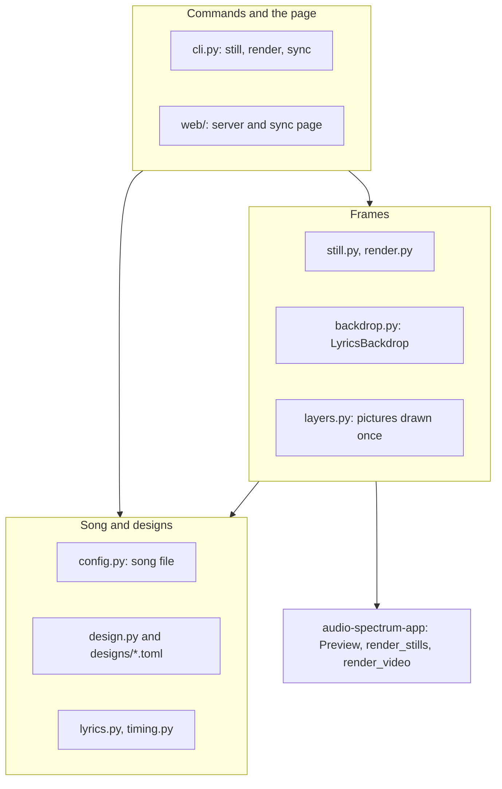
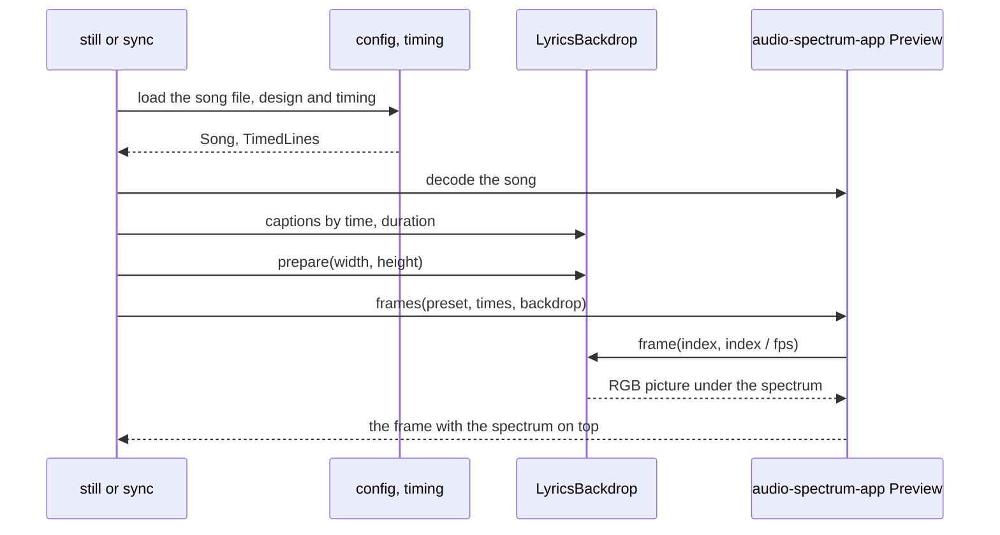
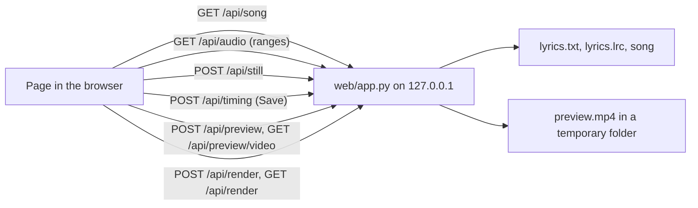

English | [日本語](../ja/ARCHITECTURE.md) · [Docs index](README.md)

# Architecture

How lyrics-video-app is built: its layers, how a song file becomes a frame, the rules every change must keep, where
time goes, and where new features fit. It is for anyone changing the code. To use the app, see the
[User guide](USER_GUIDE.md); for setup and tests, see [Development](DEVELOPMENT.md).

## 1. Layers

The app has four layers. Each one uses only the layers below it, and audio-spectrum-app is reached only through its
public API (`audio_spectrum`).

| Layer | Modules | Responsibility |
|---|---|---|
| Song and designs | `config.py`, `design.py`, `designs/*.toml`, `lyrics.py`, `timing.py`, `errors.py` | Read and validate the song file, the design with its overrides, the lyrics file and the timing file (LRC). Paths are resolved against the song file |
| Frames | `layers.py`, `backdrop.py`, `still.py`, `render.py` | Draw the parts of a frame (background, title, captions, credits), compose them by time under the spectrum, and hand them to audio-spectrum-app for stills and videos |
| audio-spectrum-app | `audio_spectrum` (another repository) | Decode the song, analyse it and draw the spectrum over this app's backdrop, for stills and videos |
| Commands and the page | `cli.py`, `web/` | Turn user actions into calls of the layers below, and write files |

Two helpers of the frames layer come from the caption images of the old workflow, which were removed in version 0.2.0:
`caption_image.py` draws the `classic` caption band with the old script's rules, and `contact_sheet.py` builds the
comparison sheet of `still`. `fonts.py` opens font files for both.

## 2. From a song file to a still

A still is the frame of the video at a time. `still` and the sync page build it the same way:

1. `config.load_song` reads the song file and resolves the design (a built-in name or a file, with the song file's
   `[design]` overrides merged over it).
2. `timing.read_lrc` reads the timing file; `backdrop.timed_captions` turns its lines into `TimedCaption`s. A caption
   ends at a pause, at the next caption's start or at the end of the song.
3. `LyricsBackdrop` gets the design, the captions and the song's duration. `prepare` draws everything that never
   changes, so missing files or fonts fail before any frame.
4. audio-spectrum-app calls `backdrop.frame(index, seconds, width, height)` for each frame and draws the spectrum
   over the returned picture.

### Whole videos

`render` builds the same backdrop and passes it to audio-spectrum-app's `render_video` (`render.py`):

1. `prepare_render` does everything that can fail quickly, in this process: it loads the song file and the timing,
   refuses an existing output, decodes the song once for its duration, checks the times and calls `prepare`, so a
   missing image or font fails before any worker starts. It returns the `RenderJob` and a summary.
2. `render` calls `render_video` with that job. audio-spectrum-app pickles the backdrop to its worker processes, calls
   `frame` there for each frame of the whole song (also for a part, from `start`), draws the spectrum on top and
   encodes the video with the audio through a temporary file.

A still is therefore the same picture as the video frame it stands for (up to H.264 compression). Ctrl+C interrupts
`render_video`, which stops its workers and removes the temporary file.

### Captions by time

The design's `lead_seconds`, `fade_seconds` and `transition` turn sung times into a window per caption (see
`caption_windows`):

- A caption starts to appear `lead` before it is sung and fades in over `fade`.
- Between captions sung back to back, `crossfade` fades the old one out while the new one fades in; `sequential`
  fades it out before the new one starts.
- At a pause, the caption fades out after its end. The last caption is gone at the end of the song.
- A window never reaches the start of the caption after next, so at most two captions are blended at once.

The sync page computes the same windows in JavaScript for its simple live preview while the song plays. Its stills and
its preview video come from the server and are drawn by `LyricsBackdrop`.

### The sync page

- `SyncSession` decodes the song once, keeps one `Preview` and one `LyricsBackdrop`, and replaces the backdrop's
  captions before each still (`set_captions`). Pictures already drawn are kept.
- The page plays the song from `/api/audio` with range requests and records key presses at the audio element's time.
  It decodes the same audio in the browser for the waveform.
- The page keeps all edits in memory. Only Save writes the timing file.
- "Preview video" starts the same `RenderTask` with `prepare_preview` (`render.py`): the page's current lines, saved
  or not, at most 960 × 540 and 15 fps, without audio (`preview_size`). The backdrop and the spectrum scale with the
  frame height, so it shows the video's design, captions and spectrum. It goes to a temporary folder of the session,
  replacing the previous preview only when done, and `GET /api/preview/video` serves it (the token is accepted in the
  URL, as for the audio). The page plays it muted and keeps it within 0.1 s of the `<audio>` element, which stays
  the one clock, and marks lines changed since the preview was made. `SyncSession.close` removes the folder when the
  server stops.
- "Render video" starts the session's `RenderTask`: `prepare_render` runs in the request, so its errors answer at
  once; `render` then runs in a background thread with `cancel` tied to the page's Cancel. The page polls the task's
  state. Only the saved timing file is rendered, one render (video or preview) at a time, and Save is refused while
  a video renders. Stopping the server cancels the render and waits for it.

## 3. Rules every change keeps

- **Frame `n` shows the audio at `n / fps`.** Captions and credits are placed by time, never by real-time playback.
- **The backdrop is picklable and pure.** It holds settings and paths only; pictures are built lazily in each process
  (`__getstate__` drops them). `frame` depends only on its arguments and never changes cached pictures.
- **Stills equal video frames.** Every preview goes through `LyricsBackdrop` and audio-spectrum-app's `Preview`, never
  through a second drawing path. Tests check this (`test_a_still_is_the_backdrop_with_the_spectrum_drawn_over_it`,
  `test_stills_are_the_frames_of_the_video`).
- **Nothing is written without an explicit command or Save.** Commands draw every image before writing any, refuse to
  overwrite without `--overwrite`, and write each file through a temporary file and a rename. The page writes only on
  Save (keeping the previous timing file as `.bak`) and on "Render video", which asks before replacing a video. The
  preview video is the one exception: it goes to a temporary folder of the session, never next to the song, and is
  removed when the server stops.
- **The page cannot be driven by other web pages.** The server listens on `127.0.0.1`, refuses foreign `Host` headers
  and API requests without the session token (accepted in the URL for the audio and the preview video only), and
  sends no cross-origin headers.
- **Only audio-spectrum-app's public API is used.** Changes it needs are planned in its own repository.
- **Errors meant for the user** are `LyricsVideoError` subclasses with the file and, for text files, the line.

## 4. Performance

The backdrop runs once per frame in audio-spectrum-app's workers, next to the spectrum (about 20 ms per 1080p frame).
How it stays cheap
([ADR-004](../working/DECISIONS.md#adr-004-text-for-video-frames-drawn-with-pillow-composed-in-numpy-in-the-render-workers)):

- Pillow draws every text layer once per process and frame size, as straight-alpha RGBA. Background and title are
  composed once; so are the fully shown credits.
- Per frame, NumPy copies the cached picture and blends only the captions of the moment, and the credits while they
  fade.
- Each process keeps the last three captions as 16-bit arrays ready to blend (`WIDE_CAPTIONS`). Workers render
  consecutive frames, so a caption is converted once per appearance; memory stays bounded however long the song is.

Measured with `tools/time_backdrop.py` on an M1 at 1080p (Phase 2): about 8 ms per frame with a caption and 17 ms
during a crossfade in the default `soft` design. A whole 279 s video with the spectrum renders in 143 s to 154 s
(51 % to 55 % of the song) in every built-in design; its preview video (960 × 540 at 15 fps) in about 19 s (7 %).
See the phase acceptance reports for the full tables.

## 5. Where new features fit

| Feature | Where | Notes |
|---|---|---|
| A new caption style | `CaptionStyle.style` in `design.py`, a `_<style>_caption` function in `layers.py` | Return one `Layer`; the backdrop caches and blends it like the others |
| Another alignment | `CaptionStyle.align` | The setting exists so song files need no change |
| A new design | A TOML file in `src/lyrics_video/designs/` | Built-in designs are found by file name |
| A new part of the frame | A style in `design.py`, a layer in `layers.py`, composition in `LyricsBackdrop` | Draw once in `_prepared_for` if it never changes; blend per frame only while it changes |
| Another timing source (MusicXML, alignment) | A reader that returns `TimedLine`s | `timing.py` writes them as LRC; the backdrop needs no change |
| A new page language | `web/static/i18n/<code>.json` and `LANGUAGES` in `app.js` | A test keeps every message file complete |
