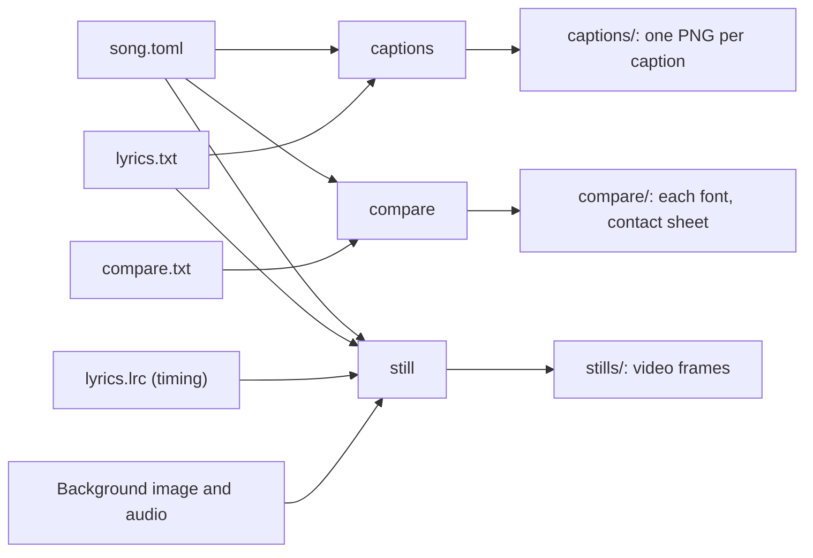

English | [日本語](../ja/USER_GUIDE.md) · [Docs index](README.md)

# User guide

How to set up lyrics-video-app, make caption images for a song, time its captions and look at frames of its video.
It is for anyone making a lyrics video with the app. Whole videos come in later phases.

Each song has a folder with a song file. Three commands read it and write images into folders next to it:



## 1. Setup

```bash
brew install uv ffmpeg
uv sync
```

audio-spectrum-app must be checked out next to this repository (`../audio-spectrum-app`); see
[Development](DEVELOPMENT.md) §1. Everything runs offline.

## 2. A folder per song

Keep each song in its own folder inside `work/`, which Git ignores, or anywhere outside the repository:

```text
work/my-song/
  song.toml      the song file: lyrics, colors, font, output folders
  lyrics.txt     one caption per line
  lyrics.lrc     when each caption is sung (optional, section 6)
  compare.txt    a line or two to try in several fonts (optional)
```

Start from the examples: copy `examples/song.example.toml` to `work/my-song/song.toml` and
`examples/lyrics.example.txt` to `work/my-song/lyrics.txt`, then edit them.

### The lyrics file

- UTF-8 text, one caption per line.
- `;` splits a caption into two rows (`first row;second row`). A line with more than one `;` is an error. Another
  separator can be set in the song file.
- Empty lines are skipped, but they still count for the numbers in the file names, as before.

## 3. Caption images: `captions`

```bash
uv run lyrics-video captions work/my-song/song.toml
```

Writes one PNG per caption into the output folder (`captions/` next to the song file by default). Files are named
`lyrics_<line index>.png`; the line index counts from 0 and includes empty lines. Each image is a band in the
background color with the caption in the text color, left-aligned:

- The font size starts at 80. It shrinks in steps of 2 until every row fits with a margin of 50 px in each
  direction. Both rows of a caption use the same size.
- One row is centered vertically; two rows sit in the upper and lower halves.

These are the rules of the old lyrics image script, so the images can be used in iMovie as before. The background
image fills the frame, and each caption image goes at the bottom, full width, with fades.

Existing images are never replaced silently:

- If any output file exists, nothing is written and the files are listed.
- Add `--overwrite` to replace them.
- If the new lyrics have fewer lines, delete the old folder first so no stale images remain.

## 4. Choosing a font: `compare`

```bash
uv run lyrics-video compare work/my-song/song.toml
uv run lyrics-video compare work/my-song/song.toml --font-dir ~/path/to/fonts --font /System/Library/Fonts/ヒラギノ明朝\ ProN.ttc
```

Draws every line of the comparison text (`compare.txt`) in every font, with the song's size and colors. The images
go into the comparison folder (`compare/` by default):

- `<font file name>_<line index>.png` for each font and line;
- `contact_sheet.png`: the first line in all fonts, one under the other, each under its font's name.

Which fonts are used:

- The fonts are `compare.fonts` and every font file in `compare.font_dirs` (searched in subfolders too).
- `--font` and `--font-dir` (each repeatable) replace both lists for one run.
- Font files are `.ttf`, `.otf`, `.ttc` and `.otc`; the first face of a collection is used.

`--overwrite` works as for `captions`.

## 5. Video stills: `still`

```bash
uv run lyrics-video still work/my-song/song.toml --time 3 62.5 --caption 4
```

Writes the frames the video will show at the given times (seconds of the song) into `stills/` next to the song file.
Files are named `<design>_<time>s.png`. Each still has the background image, the title, the captions, the credits
and the spectrum of that moment on top, exactly as the video will have them.

Which caption a still shows:

- With timing (section 6), the captions of that moment, fading as in the video. Two captions show at once while one
  replaces the other.
- `--caption` shows the line at that index (counted as in the caption image names) at every time instead, for
  example to compare designs.
- Without timing, the line given by `--caption`, or the first caption by default.
- `--no-caption` shows none.

`--overwrite` works as for `captions`.

To compare designs, name them with `--design`. The song file's design overrides (for example a title font) apply to
each, and `compare_<time>s.png` shows them one under the other at half size:

```bash
uv run lyrics-video still work/my-song/song.toml --time 62.5 --design classic soft panel
```

## 6. Timing of the captions

The times of the captions are in a timed lyrics file (LRC) next to the lyrics file. Name it in the song file:

```toml
timing = "lyrics.lrc"
```

A tapping page to make this file comes in a later version; until then it is written by hand.

### The timing file

```text
[00:12.40]first row;second row
[00:17.85]the next caption
[00:23.10]
[00:41.00]after an instrumental part
```

- UTF-8 text. Each line is a time, `[minutes:seconds.hundredths]`, then the caption, with `;` between its two rows
  as in the lyrics file. The times are when the singing starts.
- A time with no text ends the caption above it, where the singing pauses. Without it, a caption lasts until the
  next caption starts; the last one lasts until the end of the song.
- Times increase from line to line and lie inside the song. An error names the line.
- A line without a time is a caption not timed yet; it is not shown. Empty lines and tags such as `[ti:...]` are
  skipped.
- `still` takes the captions' text from this file, not from the lyrics file.

### How captions follow the time

Three design settings (section 7) decide how captions enter and leave. They can change without timing the song
again:

| Setting | Default | Meaning |
|---|---|---|
| `caption.lead_seconds` | `0.2` | A caption starts to appear this long before it is sung, so the eye is ready |
| `caption.fade_seconds` | `0.3` | How long a caption takes to fade in or out |
| `caption.transition` | `"crossfade"` | Between captions sung back to back: `"crossfade"` fades the old caption out while the new one fades in; `"sequential"` fades the old one out first, then the new one in |

At a pause, the caption starts to fade out at its end time. Captions shorter than two fades fade faster.

## 7. Designs

How the parts of a frame look is a **design**. Choose one with `design = "soft"` in the song file, or a design file
of your own with `design = "my-design.toml"`.

### Parts of a frame

A frame is made of these parts, from bottom to top:

| Part | Content |
|---|---|
| Background | `background_image`, scaled to cover the frame and cropped, never stretched; black without an image |
| Title | `title`, drawn by the app |
| Caption | The caption of the moment (section 6), fading in and out |
| Credits | The `credits` lines, shown over the first and last seconds of the song, over a darkened frame |
| Spectrum | Drawn by audio-spectrum-app with the `[spectrum]` preset and overrides |

### Built-in designs

`soft` is the default.

| Design | Title | Caption | Credits |
|---|---|---|---|
| `soft` | Small, top left, with a thin rule | Over a soft shade rising from the bottom | Small, bottom right |
| `classic` | Large, top center | An opaque band along the bottom edge, drawn with the rules of the old caption images | Centered over a darkened frame |
| `panel` | Letter-spaced, top center | In a frosted rounded box near the bottom (the background blurred behind it) | Centered, in the same kind of box |

Captions are left-aligned with up to two rows in every design, as today.

### Changing single values

Write a `[design]` table with the design's `name` and the parts to change:

```toml
[design]
name = "soft"

[design.title]
font = "~/path/to/title-font.otf"   # the title in another font than fonts.default
size = 64

[design.caption]
size = 56
```

Every part uses `fonts.default` unless it names its own `font`. Colors are `"#RRGGBB"`.

### Design keys

Sizes are in pixels of a 1080-pixel-high frame; they scale with the video height.

| Part | Keys |
|---|---|
| `background` | `focus` (`[x, y]` from 0 to 1, the point kept in view when cropping), `dim` (0 to 1), `blur` |
| `title` | `enabled`, `position` (`"top-center"`, `"top-left"`), `font`, `size`, `color`, `margin`, `letter_spacing`, `rule`, `rule_thickness`, `rule_gap`, `shadow` |
| `caption` | `style` (`"band"`, `"gradient"`, `"panel"`), `align` (`"left"`), `font`, `text_color`, `lead_seconds`, `fade_seconds`, `transition` (`"crossfade"`, `"sequential"`); band: `band_color`, `band_opacity`, `band_height`; gradient and panel: `size` (largest font size), `line_spacing`, `margin_x`, `margin_bottom`, `gradient`, `panel`, `shadow` |
| `credits` | `enabled`, `font`, `size`, `color`, `line_spacing`, `position` (`"center"`, `"bottom-right"`), `margin_x`, `margin_bottom`, `dim`, `panel`, `show_seconds`, `fade_seconds`, `shadow` |
| `spectrum` | `set`: preset overrides applied before the song file's `[spectrum] set` |
| `shadow` (in `title`, `caption`, `credits`) | `blur` (0 = no shadow), `offset`, `color`, `opacity` |
| `gradient` (in `caption`) | `height`, `color`, `opacity` (at the bottom edge) |
| `panel` (in `caption`, `credits`) | `color`, `opacity` (of the tint), `blur` (of the picture behind), `radius`, `padding` (`[x, y]`) |

## 8. The song file

A TOML file. Paths are relative to the song file; `~` is the home folder. Every key is optional except
`captions.font` for `captions` and `audio` for `still`.

| Key | Default | Meaning |
|---|---|---|
| `lyrics` | `"lyrics.txt"` | The lyrics file |
| `timing` | none | The timing file (LRC), for `still` (section 6) |
| `audio` | none | The song, for the spectrum (`still`) |
| `background_image` | none | The background image of the video |
| `title` | `""` | The song title, one line |
| `credits` | `[]` | Lines of credits, for example `["by Your Name"]` |
| `design` | `"soft"` | A design name or file, or a `[design]` table with `name` and overrides (section 7) |
| `fonts.default` | none | The font of every part of the video that does not name its own |
| `spectrum.preset` | `"default"` | An audio-spectrum-app preset name or preset file |
| `spectrum.set` | `[]` | Preset overrides, like audio-spectrum-app's `--set` |
| `video.width`, `video.height`, `video.fps` | `1920`, `1080`, `30` | Frame size and rate |
| `captions.output_dir` | `"captions"` | Folder for the caption images |
| `captions.size` | size of the background image, else `[1440, 232]` | Width and height of each image |
| `captions.background` | `"#000000"` | Background color: `"#RRGGBB"`, or an image file whose center pixel is the color |
| `captions.text_color` | `"#FFFFFF"` | Text color, the same way |
| `captions.font` | none | The font file |
| `captions.font_index` | `0` | The face in a `.ttc` collection |
| `captions.separator` | `";"` | Splits a caption into two rows |
| `captions.file_prefix` | `"lyrics"` | Start of the file names |
| `compare.text` | `"compare.txt"` | The text to compare fonts with |
| `compare.output_dir` | `"compare"` | Folder for the comparison images |
| `compare.fonts` | `[]` | Font files to compare |
| `compare.font_dirs` | `[]` | Folders whose fonts are all compared |

Fonts are not part of this repository and are never copied into it; the song file only points to them. Real song
files stay in `work/` or outside the repository.

## 9. Moving from the old lyrics image script

Instead of the old prompt (0 or 1), choose the command: `captions` or `compare`. The old `conf.toml` keys map to the
song file like this:

| Old `conf.toml` | Song file |
|---|---|
| `input.background_color` (a sample PNG) | `captions.background = "back.png"` (the same PNG, or its color as `"#RRGGBB"`); the image size becomes the caption size |
| `input.text_color` (a sample PNG) | `captions.text_color` |
| `input.lyrics_text_single` | `lyrics` |
| `input.lyrics_text_multi` | `compare.text` |
| `output.output_dir_single`, `output_dir_multi` | `captions.output_dir`, `compare.output_dir` |
| `font.font_path_single`, `font_path_multi` | `captions.font`, `compare.fonts` |
| `separator.separator` | `captions.separator` |
| `prefix.prefix_image_num` | `captions.file_prefix` |
| `margin.margin_text_x`, `margin_text_y` | Fixed at 50 |

Differences from the old script:

- The same inputs give the same sizes, colors, font sizes, layout and file names. Glyphs may sit about 1 px apart
  in places, from changes in the font libraries; the images look the same.
- A comparison image is named after the whole font file name (`my-font-2.04_0.png`; the old script cut the name at
  the first dot). The contact sheet is new.
- Existing images are not overwritten without `--overwrite`. An error in a song file, lyrics file or font writes no
  images.

## 10. Errors

| Exit code | Meaning |
|---|---|
| 0 | Done |
| 1 | Failed; the message on stderr says why (song file, lyrics or timing file, font, image, song, a caption that does not fit, existing output) |
| 2 | Wrong command-line usage |

Errors name the file and, for the lyrics and the timing, the line number. All images are drawn before any is written, so these
errors write nothing. Each file is written completely or not at all.
