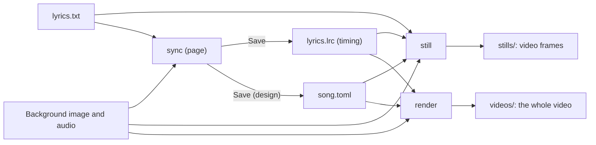

English | [日本語](../ja/USER_GUIDE.md) · [Docs index](README.md)

# User guide

How to set up lyrics-video-app, start it from the Dock, make a song from your audio, image and lyrics, time the
captions, set the look and render the whole video. It is for anyone making a lyrics video with the app. For everyday
use, read sections 1 and 2; the rest explains each part and the commands.

Each song has a song file that names its files. The page and the commands read it and write the timing and the video
next to it:



## 1. Setup

```bash
brew install uv ffmpeg
uv sync
```

audio-spectrum-app must be checked out next to this repository (`../audio-spectrum-app`); see
[Development](DEVELOPMENT.md) §1. Everything runs offline.

## 2. Everyday use

Install the app once, then start it from the Dock for every song; no terminal is needed after that.

### Install the app (once)

```bash
uv run lyrics-video install-app
```

This writes `~/Applications/Lyrics Video.app`. Drag it to the Dock.

- Clicking it opens the app's page in the browser. A click while the app runs opens its page again.
- The app runs this repository's code, so changes to the repository need no new install. After moving the
  repository or reinstalling uv, run `uv run lyrics-video install-app --overwrite`.
- Its messages go to `~/Library/Logs/lyrics-video.log`.
- Quit on the page stops it; it also stops by itself 10 minutes after its last page was closed.

### A new song

Have the audio, a background image and the lyrics as a text file (one caption per line, see "The lyrics file"),
in any folder.

1. Click the app in the Dock, then "New song…" on the start page.
2. Choose the three files, give the title and credits, and choose a design and a font. "Create and open" writes the
   song file next to the audio (`<audio name>.toml`) and opens it. Nothing is copied.
3. Tap the times (Tap mode), check them in the preview video, change the look in the Design mode, and Save.
4. "Render video" writes `videos/<song file name>.mp4` next to the song file.

The details of each step are in section 4.

### The next song

- Reuse a look: in the Design mode, "Save as design" saves the whole look, fonts and spectrum included, under a name.
  Choose that name in "New song…" for the next song.
- Open a song again from the start page's recent songs, or with "Open song…".
- If you move a song's files, the page asks for them when you open the song.

### Song files by hand

A song file is a TOML file that the page writes, and it can also be written by hand. Start from the examples: copy
`examples/song.example.toml` and `examples/lyrics.example.txt` next to your song and edit them (section 7 lists every
key). Inside this repository, keep songs in `work/`, which Git ignores:

```text
work/my-song/
  song.toml      the song file: lyrics, timing, audio, background, title, font, design
  lyrics.txt     one caption per line
  lyrics.lrc     when each caption is sung (section 4)
```

### The lyrics file

- UTF-8 text, one caption per line.
- `;` splits a caption into two rows (`first row;second row`). A line with more than one `;` is an error. Another
  separator can be set in the song file.
- Empty lines are skipped, but they still count for the line index of `still --caption`.

## 3. Video stills: `still`

```bash
uv run lyrics-video still work/my-song/song.toml --time 3 62.5 --caption 4
```

Writes the frames the video will show at the given times (seconds of the song) into `stills/` next to the song file.
Files are named `<design>_<time>s.png`. Each still has the background image, the title, the captions, the credits
and the spectrum of that moment on top, exactly as the video will have them.

Which caption a still shows:

- With timing (section 4), the captions of that moment, fading as in the video. Two captions show at once while one
  replaces the other.
- `--caption` shows the line at that index (counted from 0, empty lines included) at every time instead, for
  example to compare designs.
- Without timing, the line given by `--caption`, or the first caption by default.
- `--no-caption` shows none.

Existing images are not replaced without `--overwrite`; if one exists, nothing is written.

To compare designs, name them with `--design`. The song file's design overrides (for example a title font) apply to
each, and `compare_<time>s.png` shows them one under the other at half size:

```bash
uv run lyrics-video still work/my-song/song.toml --time 62.5 --design classic soft panel
```

## 4. Timing of the captions

The times of the captions are in a timed lyrics file (LRC) next to the lyrics file. Make it with `sync`, and name it
in the song file so that `still` uses it:

```toml
timing = "lyrics.lrc"
```

### Tapping and adjusting: `sync`

```bash
uv run lyrics-video sync work/my-song/song.toml
```

Opens a page in the browser that plays the song next to its lines. The page only works on this Mac: the server
listens on `127.0.0.1` and refuses other web pages. Stop it with Quit on the page or `Ctrl+C` in the terminal.

Without a song, start the app's start page instead:

```bash
uv run lyrics-video start
```

- The start page lists recent songs (click one to open it) and has "Open song…", which shows the Finder's dialog
  for a song file (it may open behind the browser window; a path field works too). "Songs" in the page's top bar
  comes back to it from a song.
- "New song…" makes a song file from files you already have, wherever they are: choose the audio, the background
  image and the lyrics text (each with "Choose…" or a typed path), and give the title, credits, design and font.
  - The song file goes next to the audio as `<audio name>.toml`; "Change folder…" puts it elsewhere. Its timing file
    and `videos/` go next to it. An existing song file is never replaced.
  - The files are not copied: the song file names them where they are (relative inside its folder, else by full
    path).
  - The lyrics are checked first, so a problem in them shows before anything is written.
  - The page remembers the design and font for the next new song. With a named design saved since version 0.5, the
    font can stay "Only the design's fonts".
- If a file of a song was moved or renamed, opening the song shows which file is missing; choose it again and the
  song file is updated (keeping a `.bak`).
- One song is open at a time. Opening another asks first when something is unsaved, and waits while a video renders.
- A second `start` opens the page of the app that is already running instead of starting another.
- Quit on the page stops the app (after asking, when something is unsaved or a video renders). `start` also stops by
  itself 10 minutes after its last page was closed; `sync` runs until Quit or `Ctrl+C`.
- Recent songs and the running app are kept in `~/Library/Application Support/lyrics-video/`.

1. **Tap:** press `P` to play, `Space` when the next line starts and `Enter` when the current line ends before a
   pause. `Backspace` undoes the last mark. The highlighted line starts next.
2. **Adjust:** click a time (or switch to Adjust) and correct it while listening and looking at the waveform. The
   picture above the waveform is the exact frame of the video at the playhead whenever the song is paused.
3. **Design:** change the look of the background, title, captions, credits and spectrum; the still shows each change
   at once.
   - Start from a built-in design (or the song file's design file) and change single settings: colors, opacities,
     sizes, fonts, bold and italic, boxes behind the title and credits, shadows, and the caption timing (lead, fade,
     change between lines). A changed setting is shown in bold; ↺ takes it back to the design's value.
   - The font list holds the fonts of this Mac and of the folders of the fonts your song file names.
   - Save as design: saves the whole look as it is on the page, spectrum included, under a name that any song can
     use ("Named designs" in section 6). Parts without their own font get the song's font, so the design carries its
     fonts. The page then offers to use it for this song.
   - Spectrum: choose an audio-spectrum-app preset (the built-in ones and your saved ones) and change its position,
     height, side margin, style, bar width, colors (one color or a gradient of two to four), glow and analysis (bands,
     frequencies, level, rise and fall). Analysis settings take about half a second each and apply when you release
     the slider. If the song file sets `[spectrum]` itself, a note says so: it wins over these settings ("The
     spectrum" in section 6).
   - Save writes the changes into the song file's `[design]` table (only the changed settings) and keeps the previous
     song file as `song.toml.bak`. Everything else in the song file stays as it was, comments included, except
     comments inside `[design]`. Other settings stay editable in the song file (section 6).
4. **Song:** change the title, credits, the audio, background image and lyrics files, and the default font. "Save
   and reopen the song" writes the song file (keeping a `.bak`) and opens the song again; other unsaved changes are
   lost, so the page asks first.
5. **Preview video:** before the long render, makes a quick video of the whole song and plays it in the page while
   the song plays, to check every caption change with the design and the spectrum.
   - It is made from the lines and the design as they are on the page, saved or not, in about a tenth of the song's
     length (about 20 s for a 5-minute song). It is smaller than the video (960 × 540 at 15 frames a second) and has
     no sound of its own: it follows the song in the page.
   - Lines changed after the preview are marked in the table, and the note above the picture says the preview is
     out of date (also after a design change); press the button again to see them. Paused, the picture is the exact
     still as before.
   - Cancel keeps the previous preview. The preview is kept in a temporary folder and removed when the server stops;
     nothing is written next to the song.
6. **Save:** the Save button or `⌘S` writes the timing file, and the design into the song file when it changed.
   Nothing is written before that, and leaving the page with unsaved changes asks first.
7. **Render video:** renders the whole video from the saved timing and design, as the `render` command does
   (section 5), into `videos/<song file name>.mp4`.
   - The button waits until everything is saved, so the video always matches the timing file and the song file.
   - A bar shows the progress and the time left. Cancel stops the render and leaves no file.
   - An existing video is replaced only after you confirm. When the video is done, "Show in Finder" selects it.
   - While the render runs, stills still work, but Save waits until the render is done or cancelled.
   - One render runs at a time: the video or a preview.
   - Stopping the server with `Ctrl+C` cancels a running render cleanly.

Keys in Adjust mode:

| Key | Action |
|---|---|
| `↑` `↓`, `Tab` | Previous or next line; start or end time |
| `←` `→`, `Shift`+`←` `→` | Move the selected times by 0.05 s or 0.5 s |
| `Enter` | Set the selected time to the playhead (for lines without a time) |
| `Shift`+click, `Shift`+`↑` `↓`, `⌘`+click, `⌘`+`A` | Select a range, one more line, or all lines to move together (`Esc` cancels) |
| `R`, `Space` | Play from 2 s before the selected line; play or pause |
| `Backspace`, `⌘S` | Undo (a shift of several lines is one step); save |

The markers in the zoomed waveform can also be dragged.

Details:

- The timing file is the song file's `timing`, or the lyrics file's name with `.lrc` when the key is missing (the
  page then says to add it). Save keeps the previous file as `<name>.bak`.
- The first time, the lines come from the lyrics file. Later they come from the timing file. If the lyrics file has
  changed since, the page lists the added and removed lines and keeps the times of unchanged lines (matched in
  order). New lines have no time until you set one.
- The reaction offset (in ms) is subtracted from every tapped time; it is 0 by default.
- While the song plays without a preview video, the picture is a simple preview with the design's lead, fade and
  transition only.
- The page speaks Japanese, English, Spanish and French.

### The timing file

```text
[00:12.40]first row;second row
[00:17.85]the next caption
[00:23.10]
[00:41.00]after an instrumental part
```

- UTF-8 text. Each line is a time, `[minutes:seconds.hundredths]`, then the caption, with `;` between its two rows
  as in the lyrics file. The times are when the singing starts.
- A time with no text ends the caption above it, where the singing pauses. Without it, a caption lasts until the
  next caption starts; the last one lasts until the end of the song.
- Times increase from line to line and lie inside the song. An error names the line.
- A line without a time is a caption not timed yet; it is not shown. Empty lines and tags such as `[ti:...]` are
  skipped.
- `still` takes the captions' text from this file, not from the lyrics file.

### How captions follow the time

Three design settings (section 6) decide how captions enter and leave. They can change without timing the song
again:

| Setting | Default | Meaning |
|---|---|---|
| `caption.lead_seconds` | `0.2` | A caption starts to appear this long before it is sung, so the eye is ready |
| `caption.fade_seconds` | `0.3` | How long a caption takes to fade in or out |
| `caption.transition` | `"sequential"` | Between captions sung back to back: `"sequential"` fades the old caption out first, then the new one in, so the two texts never overlap; `"crossfade"` fades the old one out while the new one fades in |

At a pause, the caption starts to fade out at its end time. Captions shorter than two fades fade faster.

## 5. The whole video: `render`

```bash
uv run lyrics-video render work/my-song/song.toml
```

Renders the lyrics video with the song's audio into `videos/<song file name>.mp4` next to the song file
(`videos/song.mp4` for `song.toml`). Its frames are the stills of section 3: the background, the title, the captions
by the timing, the credits and the spectrum on top. Size and frame rate come from the song file's `[video]`.

Before the long part starts, `render` checks everything that can fail quickly (the song file, the timing, the
background image, the fonts, an existing video) and prints a summary:

```text
Song: Song Title (song.wav, 279.5 s)
Design: soft; timed captions: 18
Rendering work/my-song/videos/song.mp4
```

Check the title and the audio file there: a song file copied from another song shows it at once.

- The song file needs `audio` and `timing`.
- Lines without a time are listed in a warning and left out of the video, which is handy for a draft.
- Progress is shown on stderr. `Ctrl+C` stops the render and leaves no file.
- An existing video is not replaced without `--overwrite`. The video is written to a temporary file first, so a file
  with the final name is always complete.
- A 4.7-minute song takes about 2.5 minutes on an M1 Mac and gives a file of about 125 MB.

To check one part before rendering the whole song, give its start and length:

```bash
uv run lyrics-video render work/my-song/song.toml --start 60 --duration 15
```

This writes `videos/song_60s-75s.mp4` (`song_60s-end.mp4` without `--duration`). Its frames are the same as the whole
video's at those times, and its audio is cut to match.

| Option | Default | Meaning |
|---|---|---|
| `-o`, `--output FILE` | `videos/<song file name>.mp4` | Another video file: `.mp4` for H.264, `.mov` for ProRes |
| `--overwrite` | off | Replace an existing video |
| `--start SECONDS`, `--duration SECONDS` | the whole song | Render only part of the song |
| `--design NAME` | the song file's | Another design, a built-in name or a file; the song file's design overrides apply |
| `--workers N` | `0` (automatic) | Render processes; `1` renders in a single process |
| `--codec CODEC` | `h264` | `h264` or `prores` (ProRes 422, much larger files for editing) |
| `--crf N` | `18` | H.264 quality from 0 to 51; lower is better and larger |

## 6. Designs

How the parts of a frame look is a **design**. Choose one with `design = "soft"` in the song file, or a design file
of your own with `design = "my-design.toml"`.

### Parts of a frame

A frame is made of these parts, from bottom to top:

| Part | Content |
|---|---|
| Background | `background_image`, scaled to cover the frame and cropped, never stretched; black without an image |
| Title | `title`, drawn by the app |
| Caption | The caption of the moment (section 4), fading in and out |
| Credits | The `credits` lines, shown over the first and last seconds of the song, over a darkened frame |
| Spectrum | Drawn by audio-spectrum-app with a preset and changes from the design and the song file (see "The spectrum") |

### Built-in designs

`soft` is the default.

| Design | Title | Caption | Credits |
|---|---|---|---|
| `soft` | Small, top left, with a thin rule | Over a soft shade rising from the bottom | Small, bottom right |
| `classic` | Large, top center | An opaque band along the bottom edge, drawn with the rules of the old caption images | Centered over a darkened frame |
| `panel` | Letter-spaced, top center | In a frosted rounded box near the bottom (the background blurred behind it) | Centered, in the same kind of box |

Captions are left-aligned with up to two rows in every design, as today.

### Named designs

Save the look of one song and use it for others: "Save as design" in the Design mode of the `sync` page writes the
whole look as it is on the page (built-in design, changes and spectrum) under a name you choose. Any song file then
uses it like a built-in design:

```toml
design = "Summer Rain"
```

- Named designs live in `~/Library/Application Support/lyrics-video/designs/`, one TOML file each, in the same form
  as a design file. "Show designs folder" opens it in the Finder, where you rename or delete them.
- `still --design` and `render --design` accept the names too, and the page lists them next to the built-in designs.
- A name can be any file name, Japanese included, except a built-in design's; it cannot contain `/` or `:`, start
  with a dot or end with `.toml`. Saving under an existing name asks first and keeps the previous file as `.bak`.
- Fonts and preset files are named by their full paths, so the design works from any song folder. They are not
  copied: on another Mac the same files must exist. Parts without their own font use the song file's
  `fonts.default`.
- A name is looked up among the built-in designs first, then the named designs, then as a file next to the song
  file.

### Changing single values

Change them in the Design mode of the `sync` page (section 4), or write a `[design]` table with the design's `name`
and the parts to change:

```toml
[design]
name = "soft"

[design.title]
font = "~/path/to/title-font.otf"   # the title in another font than fonts.default
size = 64

[design.caption]
size = 56
bold = true                         # synthetic bold

[design.title.panel]                # a box behind the title
color = "#000000"
opacity = 0.5
blur = 0                            # 0: a plain see-through box; more: frosted glass
```

Every part uses `fonts.default` unless it names its own `font`. Colors are `"#RRGGBB"`.

Bold and italic:

- `bold` and `italic` draw any font bolder or slanted (by 12°). Japanese fonts have no italic face, so this is the
  only way to slant them.
- `panel = false` turns off a box that the design has (the `panel` design's credits box, for example).
- A heavier font looks better than synthetic bold where one exists: name its file as `font` (Hiragino has one file
  per weight, such as W6), or its face in a font collection (`.ttc`) as `font_face`, counted from 0.

### The spectrum

The design holds the spectrum too: an audio-spectrum-app preset and changes to its keys, written as the preset's own
tables. The Design mode of the `sync` page writes them for you. A design saved with the spectrum therefore keeps the
whole look of a video.

```toml
[design.spectrum]
preset = "default"            # an audio-spectrum-app preset name, or a preset file relative to the song file
foreground = "#FFFFFF"        # the line color

[design.spectrum.look]
baseline_y = 0.55             # keys of audio-spectrum-app's [look], [analysis], [fill] and [fx] tables
max_height = 0.25
```

The spectrum is built in this order, from the base to the most specific:

1. The preset: the song file's `[spectrum] preset` if it names one, else the design's `preset`, else `default`.
2. The design's changes: `foreground`, then the `analysis`, `look`, `fill` and `fx` tables, then the design's `set`.
3. The song file's `[spectrum] set`.

The keys are audio-spectrum-app's; see its user guide. They are checked when the song file loads, so a wrong key
stops every command at once with the song file's name. `look.kind` cannot be changed: the preset decides between the
flat and the perspective look. The preset's `background` color is never seen, since the video's backdrop is drawn
instead.

### Design keys

Sizes are in pixels of a 1080-pixel-high frame; they scale with the video height.

| Part | Keys |
|---|---|
| `background` | `focus` (`[x, y]` from 0 to 1, the point kept in view when cropping), `dim` (0 to 1), `blur` |
| `title` | `enabled`, `position` (`"top-center"`, `"top-left"`), `font`, `font_face`, `bold`, `italic`, `size`, `color`, `margin`, `letter_spacing`, `rule`, `rule_thickness`, `rule_gap`, `panel` (none by default), `shadow` |
| `caption` | `style` (`"band"`, `"gradient"`, `"panel"`), `align` (`"left"`), `font`, `font_face`, `bold`, `italic`, `text_color`, `lead_seconds`, `fade_seconds`, `transition` (`"sequential"`, `"crossfade"`); band: `band_color`, `band_opacity`, `band_height`; gradient and panel: `size` (largest font size), `line_spacing`, `margin_x`, `margin_bottom`, `gradient`, `panel`, `shadow` |
| `credits` | `enabled`, `font`, `font_face`, `bold`, `italic`, `size`, `color`, `line_spacing`, `position` (`"center"`, `"bottom-right"`), `margin_x`, `margin_bottom`, `dim`, `panel`, `show_seconds`, `fade_seconds`, `shadow` |
| `spectrum` | `preset`, `foreground`, the tables `analysis`, `look`, `fill`, `fx` (keys of an audio-spectrum-app preset), and `set` (`--set` overrides); see "The spectrum" |
| `shadow` (in `title`, `caption`, `credits`) | `blur` (0 = no shadow), `offset`, `color`, `opacity` |
| `gradient` (in `caption`) | `height`, `color`, `opacity` (at the bottom edge) |
| `panel` (in `title`, `caption`, `credits`) | `color`, `opacity` (of the tint), `blur` (of the picture behind), `radius`, `padding` (`[x, y]`) |

## 7. The song file

A TOML file. Paths are relative to the song file; `~` is the home folder. Every key is optional except
`audio` for `still`, and `audio` and `timing` for `render`.

| Key | Default | Meaning |
|---|---|---|
| `lyrics` | `"lyrics.txt"` | The lyrics file |
| `separator` | `";"` | Splits a caption into two rows, in the lyrics and the timing file |
| `timing` | none | The timing file (LRC), for `still` and `render` (section 4) |
| `audio` | none | The song, for the spectrum and the video's audio (`still`, `render`) |
| `background_image` | none | The background image of the video |
| `title` | `""` | The song title, one line |
| `credits` | `[]` | Lines of credits, for example `["by Your Name"]` |
| `design` | `"soft"` | A design name (built-in or saved) or design file, or a `[design]` table with `name` and overrides (section 6) |
| `fonts.default` | none | The font of every part of the video that does not name its own |
| `spectrum.preset` | the design's, else `"default"` | An audio-spectrum-app preset name or preset file; wins over the design's |
| `spectrum.set` | `[]` | Preset overrides, like audio-spectrum-app's `--set`, applied after the design's changes |
| `video.width`, `video.height`, `video.fps` | `1920`, `1080`, `30` | Frame size and rate |

Fonts are not part of this repository and are never copied into it; the song file only points to them. Real song
files stay in `work/` or outside the repository.

Song files from version 0.1 may still have the `[captions]` and `[compare]` sections of the removed caption image
commands. They now stop with an error that names them: delete them, and if `[captions]` set a `separator`, write it at
the top instead.

## 8. Errors

| Exit code | Meaning |
|---|---|
| 0 | Done |
| 1 | Failed; the message on stderr says why (song file, lyrics or timing file, font, image, song, existing output) |
| 2 | Wrong command-line usage |
| 130 | `render` was stopped with `Ctrl+C`; no video was written |

Errors name the file and, for the lyrics and the timing, the line number. `still` draws all images before writing
any, and `render` checks everything before it starts, so these errors write nothing. Each file is written completely
or not at all.
