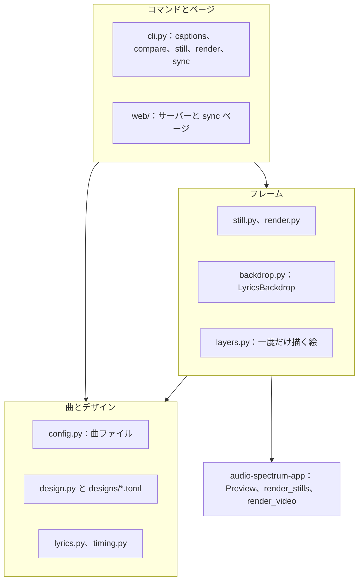
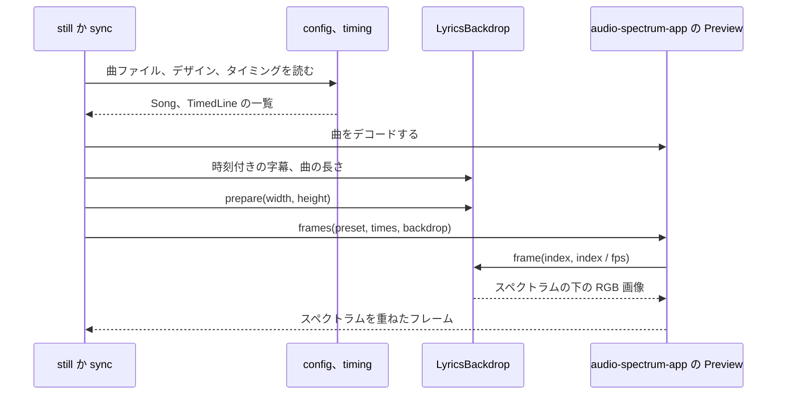
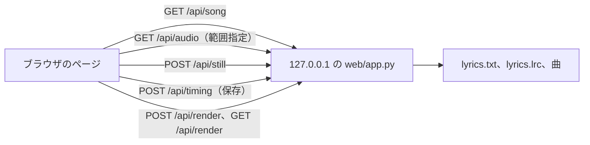

<!-- source: docs/en/ARCHITECTURE.md blob be89ccbdc33c14499beee0a71f78bd956c2ac3bb -->
[English](../en/ARCHITECTURE.md) | 日本語 · [目次に戻る](README.md)

> この文書は[英語版](../en/ARCHITECTURE.md)の翻訳。内容が異なる場合は英語版が優先する。

# アーキテクチャ

lyrics-video-app の作りをまとめる。層の分け方、曲ファイルがフレームになるまでの流れ、どの変更でも守る決まり、時間のかかる箇所、
新しい機能の置き場所を扱う。コードを変える人向け。使い方は[ユーザーガイド](USER_GUIDE.md)、セットアップとテストは[開発](DEVELOPMENT.md)を見る。

## 1. 層

アプリは 4 つの層でできている。各層は自分より下の層だけを使い、audio-spectrum-app には公開 API（`audio_spectrum`）だけを通して触れる。

| 層 | モジュール | 役割 |
|---|---|---|
| 曲とデザイン | `config.py`、`design.py`、`designs/*.toml`、`lyrics.py`、`timing.py`、`errors.py` | 曲ファイル、上書きを反映したデザイン、歌詞ファイル、タイミングファイル（LRC）を読んで検証する。パスは曲ファイルを基準に解決する |
| フレーム | `layers.py`、`backdrop.py`、`still.py`、`render.py` | フレームの部品（背景、曲名、字幕、クレジット）を描き、時刻に合わせてスペクトラムの下に重ね、静止画や動画のために audio-spectrum-app へ渡す |
| audio-spectrum-app | `audio_spectrum`（別リポジトリ） | 曲をデコードして解析し、このアプリの backdrop の上にスペクトラムを描く。静止画にも動画にも使う |
| コマンドとページ | `cli.py`、`web/` | 利用者の操作を下の層の呼び出しに変え、ファイルを書く |

旧来の字幕画像（`captions.py`、`caption_image.py`、`fonts.py`、`contact_sheet.py`）はフレームの層の横にある。
最初の動画全体が iMovie のワークフローに代わった時点で削除する（[Phase 3 plan](../working/PHASE3_PLAN.md)）。

## 2. 曲ファイルから静止画まで

静止画は、ある時刻の動画のフレームそのもの。`still` も sync ページも同じ手順で作る。

1. `config.load_song` が曲ファイルを読み、デザインを決める。デザインは組み込みの名前かファイルで、曲ファイルの `[design]` の上書きをその上に重ねる。
2. `timing.read_lrc` がタイミングファイルを読み、`backdrop.timed_captions` がその行を `TimedCaption` に変える。
   字幕は、歌の途切れ、次の字幕の開始、曲の終わりのいずれかで終わる。
3. `LyricsBackdrop` はデザイン、字幕、曲の長さを受け取る。`prepare` は変わらない部分をすべて先に描くので、ファイルやフォントが
   見つからなければフレームを描く前に失敗する。
4. audio-spectrum-app がフレームごとに `backdrop.frame(index, seconds, width, height)` を呼び、返った画像の上にスペクトラムを描く。

### 動画全体

`render` は同じ backdrop を作り、audio-spectrum-app の `render_video` に渡す（`render.py`）。

1. `prepare_render` は、すぐ失敗しうる処理をこのプロセスで済ませる。曲ファイルとタイミングを読み、既存の出力を断り、曲を一度デコードして長さを求め、
   時刻を確かめ、`prepare` を呼ぶ。そのため画像やフォントが見つからなければ、ワーカーを起動する前に失敗する。返り値は `RenderJob` と概要だ。
2. `render` がそのジョブで `render_video` を呼ぶ。audio-spectrum-app は backdrop を pickle してワーカープロセスに送り、
   曲全体のフレームごとに（一部だけのときも `start` から）そこで `frame` を呼び、上にスペクトラムを描き、一時ファイルを通して音声付きの動画にする。

そのため静止画は、対応する動画のフレームと（H.264 の圧縮を除けば）同じ画像になる。Ctrl+C は `render_video` を中断し、
ワーカーを止めて一時ファイルを消す。

### 時刻に合わせた字幕

デザインの `lead_seconds`、`fade_seconds`、`transition` が、歌う時刻を字幕ごとの表示区間に変える（`caption_windows`）。

- 字幕は歌う `lead` 秒前から現れ始め、`fade` 秒かけて濃くなる。
- 続けて歌う字幕の間では、`crossfade` なら古い字幕が消えていくのと同時に新しい字幕が現れる。`sequential` なら古い字幕は新しい字幕が現れ始める前に消えきる。
- 歌が途切れるところでは、終わりの時刻から消え始める。最後の字幕は曲の終わりで消えきる。
- 表示区間は 2 つ先の字幕の開始を越えないので、同時に重ねる字幕は 2 つまで。

sync ページは再生中の簡易表示のために、同じ区間を JavaScript で計算する。静止画はサーバーが描くので正確。

### sync ページ

- `SyncSession` は曲を一度だけデコードし、`Preview` と `LyricsBackdrop` を 1 つずつ持つ。静止画を描く前に backdrop の字幕を差し替える
  （`set_captions`）。描き終えた絵はそのまま使い回す。
- ページは `/api/audio` から範囲リクエストで曲を再生し、キーを押した時点の audio 要素の時刻を記録する。波形用に同じ音声をブラウザでもデコードする。
- 編集はすべてページのメモリに置く。タイミングファイルに書くのは保存のときだけ。
- 「動画を書き出す」はセッションの `RenderTask` を始める。`prepare_render` はリクエストの中で動くので、エラーはすぐに返る。
  そのあと `render` がバックグラウンドのスレッドで動き、`cancel` はページのキャンセルにつながる。ページはタスクの状態を定期的に問い合わせる。
  書き出すのは保存済みのタイミングファイルだけで、一度に 1 つ。書き出し中の保存は断る。サーバーを止めると書き出しをキャンセルし、終わるまで待つ。

## 3. どの変更でも守る決まり

- **フレーム `n` は時刻 `n / fps` の音声を映す。** 字幕とクレジットは時刻で置き、実時間の再生には頼らない。
- **backdrop は pickle でき、副作用がない。** 持つのは設定とパスだけで、絵は各プロセスで必要になったときに作る（`__getstate__` が捨てる）。
  `frame` の結果は引数だけで決まり、キャッシュした絵を書き換えない。
- **静止画は動画のフレームと一致する。** プレビューはすべて `LyricsBackdrop` と audio-spectrum-app の `Preview` を通し、別の描画経路を作らない。
  テストで確かめている（`test_a_still_is_the_backdrop_with_the_spectrum_drawn_over_it`、`test_stills_are_the_frames_of_the_video`）。
- **明示的なコマンドか保存なしには何も書かない。** コマンドはすべての画像を描き終えてから書き、`--overwrite` なしには上書きせず、
  各ファイルを一時ファイルと名前の変更で書く。ページが書くのは保存のとき（前のタイミングファイルを `.bak` として残す）と「動画を書き出す」のときだけで、
  既存の動画を置き換える前には確認する。
- **ほかの Web ページからページを操作させない。** サーバーは `127.0.0.1` で待ち受け、想定外の `Host` ヘッダーとセッショントークンのない
  API リクエストを拒む（URL のトークンは音声だけで有効）。クロスオリジン用のヘッダーは送らない。
- **audio-spectrum-app は公開 API だけを使う。** あちらに必要な変更は、あちらのリポジトリで計画する。
- **利用者向けのエラー**は `LyricsVideoError` のサブクラスで、ファイル名と、テキストファイルなら行番号を示す。

## 4. 性能

backdrop は audio-spectrum-app のワーカーで、スペクトラム（1080p で 1 フレーム約 20 ms）と並んでフレームごとに 1 回動く。軽く保つしくみは次のとおり
（[ADR-004](../working/DECISIONS.md#adr-004-text-for-video-frames-drawn-with-pillow-composed-in-numpy-in-the-render-workers)、英語のみ）。

- Pillow は文字の層をプロセスとフレームサイズごとに一度だけ、ストレートアルファの RGBA として描く。背景と曲名は一度だけ重ね、完全に表示した
  クレジットも同じく一度だけ重ねる。
- フレームごとには、キャッシュした画像を NumPy でコピーし、その時点の字幕と、フェード中のクレジットだけを重ねる。
- 各プロセスは直近 3 つの字幕を、すぐ重ねられる 16 ビット配列で持つ（`WIDE_CAPTIONS`）。ワーカーは連続したフレームを描くので、
  変換は字幕が現れるたびに 1 回で済み、曲が長くてもメモリは増えない。

`tools/time_backdrop.py` による M1、1080p での計測（Phase 2）では、既定の `soft` デザインで字幕ありが約 8 ms、クロスフェード中が約 17 ms。
スペクトラム付きで 279 秒の動画全体を書き出すと、どの組み込みデザインでも 143〜154 秒（曲の長さの 51〜55 %）かかる。
全体の表は各フェーズの受け入れ報告にある。

## 5. 新しい機能の置き場所

| 機能 | 置き場所 | 補足 |
|---|---|---|
| 新しい字幕の見た目 | `design.py` の `CaptionStyle.style` と、`layers.py` の `_<style>_caption` 関数 | `Layer` を 1 つ返せば、backdrop がほかと同じくキャッシュして重ねる |
| 別の揃え方 | `CaptionStyle.align` | 設定はすでにあるので、曲ファイルを変えずに済む |
| 新しいデザイン | `src/lyrics_video/designs/` の TOML ファイル | 組み込みデザインはファイル名で見つける |
| フレームの新しい部品 | `design.py` のスタイル、`layers.py` の層、`LyricsBackdrop` での重ね方 | 変わらないものは `_prepared_for` で一度だけ描き、変わる間だけフレームごとに重ねる |
| 別のタイミングの出どころ（MusicXML、自動合わせ） | `TimedLine` の一覧を返す読み込み関数 | `timing.py` が LRC として書く。backdrop は変えなくてよい |
| ページの新しい言語 | `web/static/i18n/<code>.json` と `app.js` の `LANGUAGES` | すべてのメッセージファイルがそろっているかをテストで確かめる |
