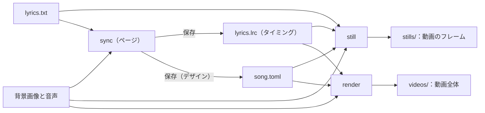

<!-- source: docs/en/USER_GUIDE.md blob c8dde05a94efb74bba0db7031b96e7c0a1b3ee9f -->
[English](../en/USER_GUIDE.md) | 日本語 · [目次に戻る](README.md)

> この文書は[英語版](../en/USER_GUIDE.md)の翻訳。内容が異なる場合は英語版が優先する。

# ユーザーガイド

lyrics-video-app をセットアップして Dock から起動し、手元の音声・画像・歌詞から曲を作り、字幕にタイミングを付け、見た目を決めて動画全体を
書き出す手順をまとめる。このアプリで歌詞動画を作る人向け。普段使うだけなら 1 節と 2 節を読めばよい。残りの節で各部分とコマンドを説明する。

曲ごとに、使うファイルを指す曲ファイルがある。ページとコマンドはそれを読み、タイミングと動画をその隣に書き出す。



## 1. セットアップ

```bash
brew install uv ffmpeg
uv sync
```

audio-spectrum-app をこのリポジトリの隣（`../audio-spectrum-app`）に置いておく必要がある。[開発](DEVELOPMENT.md) §1 を参照。
すべてオフラインで動く。

## 2. 普段の使い方

アプリを一度インストールしたら、あとは曲ごとに Dock から起動する。それ以降ターミナルは要らない。

### アプリのインストール（最初の一度だけ）

```bash
uv run lyrics-video install-app
```

`~/Applications/Lyrics Video.app` ができる。これを Dock にドラッグする。

- クリックするとブラウザでアプリのページが開く。動いている間にもう一度クリックすると、そのページをまた開く。
- アプリはこのリポジトリのコードを動かすので、リポジトリを更新しても入れ直しは要らない。リポジトリを移動したり uv を入れ直したりしたら、
  `uv run lyrics-video install-app --overwrite` を実行する。
- メッセージは `~/Library/Logs/lyrics-video.log` に出る。
- ページの「終了」で止まる。最後のページを閉じて 10 分たつと自動でも止まる。

### 新しい曲

音声、背景画像、歌詞のテキストファイル（1 行に 1 字幕。「歌詞ファイル」を参照）を用意する。置き場所はどこでもよい。

1. Dock のアプリをクリックし、開始ページの「新しい曲…」を押す。
2. 3 つのファイルを選び、曲名とクレジットを入れ、デザインとフォントを選ぶ。「作成して開く」で、音声の隣に曲ファイル
   （`<音声の名前>.toml`）を書いて開く。ファイルはコピーしない。
3. タップで時刻を付け（タップモード）、プレビュー動画で確かめ、デザインモードで見た目を変えて保存する。
4. 「動画を書き出す」で、曲ファイルの隣に `videos/<曲ファイル名>.mp4` を書き出す。

各手順の詳細は 4 節にある。

### 次の曲

- 見た目を使い回す：デザインモードの「デザインとして保存」で、フォントとスペクトラムを含む見た目全体に名前を付けて保存する。
  次の曲の「新しい曲…」でその名前を選ぶ。
- 曲をまた開くには、開始ページの最近の曲か「曲を開く…」を使う。
- 曲のファイルを移動した場合は、曲を開くときにページがファイルを選び直させる。

### 曲ファイルを手で書く

曲ファイルはページが書く TOML ファイルで、手で書くこともできる。例のファイルから始めるとよい。`examples/song.example.toml` と
`examples/lyrics.example.txt` を曲の隣にコピーして編集する（キーの一覧は 7 節）。このリポジトリの中なら、Git の対象外である `work/` に置く。

```text
work/my-song/
  song.toml      曲ファイル：歌詞、タイミング、音声、背景、曲名、フォント、デザイン
  lyrics.txt     1 行に 1 字幕
  lyrics.lrc     各字幕を歌う時刻（4 節）
```

### 歌詞ファイル

- UTF-8 のテキストで、1 行が 1 つの字幕。
- `;` で字幕を 2 行に分ける（`1 行目;2 行目`）。`;` が 2 つ以上ある行はエラーになる。区切り文字は曲ファイルで変えられる。
- 空行は飛ばす。ただし、`still --caption` の行番号には数える。

## 3. 動画の静止画：`still`

```bash
uv run lyrics-video still work/my-song/song.toml --time 3 62.5 --caption 4
```

指定した時刻（曲の秒数）に動画が映すフレームを、曲ファイルの隣の `stills/` に書き出す。ファイル名は `<デザイン>_<時刻>s.png`。
静止画には背景画像、曲名、その時点の字幕、クレジット、スペクトラムが重なっていて、動画のフレームとまったく同じになる。

静止画に出る字幕は次のとおり。

- タイミング（4 節）があれば、その時点の字幕を動画と同じフェードで出す。字幕が入れ替わる間は 2 つが重なる。
- `--caption` を付けると、どの時刻でもその行番号の字幕（0 から数え、空行も数える）を出す。デザインを見比べるときに使う。
- タイミングがなければ、`--caption` で指定した行、省略すると最初の字幕を出す。
- `--no-caption` なら字幕なし。

既存の画像は `--overwrite` なしでは置き換えない。1 つでもあれば何も書き出さない。

デザインを見比べるときは、`--design` に名前を並べる。曲ファイルに書いたデザインの上書き（曲名のフォントなど）はどのデザインにも効く。
`compare_<時刻>s.png` には、それらを半分の大きさで縦に並べる。

```bash
uv run lyrics-video still work/my-song/song.toml --time 62.5 --design classic soft panel
```

## 4. 字幕のタイミング

字幕の時刻は、歌詞ファイルの隣に置くタイミング付き歌詞ファイル（LRC）に書く。このファイルは `sync` で作る。
`still` がこれを使うよう、曲ファイルで名前を指定する。

```toml
timing = "lyrics.lrc"
```

### タップと調整：`sync`

```bash
uv run lyrics-video sync work/my-song/song.toml
```

ブラウザでページを開き、行の一覧の横で曲を再生する。ページはこの Mac の中でしか使えない。サーバーは `127.0.0.1` だけで待ち受け、
ほかの Web ページからの操作を拒む。止めるにはページの「終了」か、ターミナルで `Ctrl+C` を押す。

曲を指定せずに、アプリの開始ページから始めることもできる。

```bash
uv run lyrics-video start
```

- 開始ページには最近の曲が並び、クリックで開ける。「曲を開く…」は曲ファイルを選ぶ Finder のダイアログを出す（ブラウザの後ろに開くことが
  ある。パスの入力欄も使える）。曲を開いた後は、上のバーの「曲一覧」で開始ページに戻れる。
- Finder のダイアログが開いている間、ページは覆われてダイアログを待つ。続けてクリックしても二つ目は開かない。
- 上のバーの「使い方」は、Dock からの起動から「終了」までの手順を出す。最初の曲を開くまでは、開始ページが自動で出す。
- 「新しい曲…」は、手元にあるファイルから曲ファイルを作る。ファイルはどこにあってもよい。音声、背景画像、歌詞のテキストを選び（それぞれ
  「選択…」かパスの入力）、曲名、クレジット、デザイン、フォントを入れる。
  - 曲ファイルは音声の隣に `<音声の名前>.toml` として置く。「フォルダを変更…」で別の場所にもできる。タイミングファイルと `videos/` は
    曲ファイルの隣にできる。既存の曲ファイルは置き換えない。
  - ファイルはコピーせず、今ある場所のまま曲ファイルに書く（曲ファイルのフォルダの中なら相対パス、外ならフルパス）。
  - 先に歌詞を確かめるので、歌詞に問題があれば何も書く前にわかる。
  - デザインとフォントは次の新しい曲のために覚えておく。バージョン 0.5 以降に保存した名前付きデザインなら、フォントは「デザインの
    フォントだけ」のままでよい。
- 曲のファイルを移動したり名前を変えたりした後にその曲を開くと、見つからないファイルが表示される。選び直すと曲ファイルを更新する
  （`.bak` を残す）。
- 開ける曲は一度に 1 曲。ほかの曲を開くとき、保存していない変更があれば確認し、動画の書き出し中は待つ。
- 2 回目の `start` は、新しく起動せず、動いているアプリのページを開く。
- ページの「終了」でアプリを止める（保存していない変更や書き出し中の動画があれば確認する）。`start` は最後のページを閉じて 10 分たつと
  自動でも止まる。`sync` は「終了」か `Ctrl+C` まで動く。
- 最近の曲と動いているアプリの情報は `~/Library/Application Support/lyrics-video/` に置く。

1. **タップ：** `P` で再生し、次の行が始まったら `Space`、歌が途切れる前に今の行が終わったら `Enter` を押す。`Backspace` で直前の印を取り消す。
   色の付いた行が次に始まる行。
2. **調整：** 時刻をクリックする（または「調整」に切り替える）と、聴きながら波形を見て直せる。一時停止中は、波形の上の画像が
   再生位置での動画とまったく同じフレームになる。
3. **デザイン：** 背景、曲名、字幕、クレジット、スペクトラムの見た目を変える。変更はすぐ静止画に出る。
   - 組み込みのデザイン（または曲ファイルが指定するデザインファイル）から始め、設定を一つずつ変える。色、不透明度、大きさ、フォント、
     太字と斜体、曲名とクレジットの背景のボックス、影、字幕のタイミング（先行、フェード、行の切り替え）を変えられる。
     変えた設定は太字で表示され、↺ でデザインの値に戻る。
   - フォントの一覧には、この Mac のフォントと、曲ファイルが指定するフォントのフォルダにあるフォントが並ぶ。
   - デザインとして保存：ページ上の今の見た目全体を、スペクトラムも含めて名前を付けて保存する。どの曲からもその名前で使える
     （6 節の「名前付きデザイン」）。自分のフォントを持たない部品には曲のフォントを書き込むので、デザインがフォントも持つ。
     保存したあと、この曲に使うかを尋ねる。
   - スペクトラム：audio-spectrum-app のプリセット（組み込みのものと保存したもの）を選び、位置、高さ、左右の余白、スタイル、棒の太さ、
     色（単色か、2〜4 色のグラデーション）、光、解析（バンド数、周波数、レベル、立ち上がりと減衰）を変えられる。解析の設定は 1 回に
     0.5 秒ほどかかるので、スライダーを離したときに反映する。曲ファイル自身が `[spectrum]` を指定していれば注記が出る。そちらがここの
     設定より優先される（6 節の「スペクトラム」）。
   - 保存すると、変えた設定だけを曲ファイルの `[design]` テーブルに書き込み、前の曲ファイルを `song.toml.bak` として残す。
     曲ファイルのほかの部分はコメントも含めてそのまま残る。ただし `[design]` の中のコメントは残らない。ほかの設定は曲ファイルで変えられる（6 節）。
4. **曲の設定：** 曲名、クレジット、音声・背景画像・歌詞のファイル、既定のフォントを変える。「保存して曲を開き直す」で曲ファイルに
   書き込み（`.bak` を残す）、曲を開き直す。ほかの保存していない変更は失われるので、先に確認する。
5. **プレビュー動画：** 時間のかかる書き出しの前に、曲全体の簡易動画を作り、曲の再生に合わせてページで流す。字幕の切り替わりを、
   デザインとスペクトラム込みで確かめられる。
   - ページ上の今の行とデザインから作る。保存していなくてもよい。かかる時間は曲の長さの 1 割ほど（5 分の曲で約 20 秒）。本番の動画より小さく
     （960 × 540、毎秒 15 フレーム）、音は持たない。ページで再生する曲に合わせて動く。
   - プレビューの後に変えた行は表に印が付き、画像の上の注記もプレビューが古いと知らせる（デザインを変えたときも同じ）。もう一度ボタンを押すと反映される。
     一時停止中の画像は、これまでどおり正確な静止画になる。
   - キャンセルしても前のプレビューは残る。プレビューは一時フォルダに置き、サーバーを止めると消える。曲のフォルダには何も書かない。
6. **保存：** 保存ボタンか `⌘S` でタイミングファイルに書き込む。デザインを変えていれば、曲ファイルにも書き込む。それまでは何も書き込まない。
   保存していない変更があるままページを離れようとすると確認が出る。
7. **動画を書き出す：** 保存したタイミングとデザインで、`render` コマンド（5 節）と同じく動画全体を `videos/<曲ファイル名>.mp4` に書き出す。
   - ボタンはすべて保存するまで押せない。そのため動画は常にタイミングファイルや曲ファイルと一致する。
   - バーに進捗と残り時間が出る。キャンセルすると書き出しを止め、ファイルは残らない。
   - 既存の動画は、確認してから置き換える。書き出しが終わると「Finder で表示」で動画を選択できる。
   - 書き出し中も静止画は使えるが、保存は書き出しが終わるかキャンセルするまで待つ。
   - 書き出しは一度に一つだけ。動画とプレビューも同時には動かない。
   - `Ctrl+C` でサーバーを止めると、書き出し中の処理もきれいにキャンセルする。

調整モードのキー：

| キー | 操作 |
|---|---|
| `↑` `↓`、`Tab` | 前後の行へ移る。開始と終了を切り替える |
| `←` `→`、`Shift`+`←` `→` | 選んだ時刻を 0.05 秒か 0.5 秒ずらす |
| `Enter` | 選んだ時刻を再生位置にする（時刻のない行に使う） |
| `Shift`+クリック、`Shift`+`↑` `↓`、`⌘`+クリック、`⌘`+`A` | 範囲、1 行追加、全行を選び、まとめてずらす（`Esc` で解除） |
| `R`、`Space` | 選んだ行の 2 秒前から再生する。再生と一時停止 |
| `Backspace`、`⌘S` | 取り消す（複数行をまとめてずらした操作は 1 回で戻る）。保存する |

拡大波形のマーカーはドラッグでも動かせる。

補足：

- タイミングファイルは曲ファイルの `timing` で決まる。このキーがなければ歌詞ファイルの名前の拡張子を `.lrc` にしたファイルになり、
  ページがキーを書き足すよう案内する。保存するとき、前のファイルを `<名前>.bak` として残す。
- 初回は歌詞ファイルから、2 回目からはタイミングファイルから行を読む。その間に歌詞ファイルが変わっていれば、追加と削除の行を一覧にし、
  変わっていない行（順に照合する）の時刻は残す。新しい行には自分で時刻を付けるまで時刻がない。
- 反応オフセット（ms）は、タップした時刻から毎回差し引く。既定は 0。
- プレビュー動画がないときの再生中の画像は、デザインの先行、フェード、切り替え方だけに従った簡易表示になる。
- ページは日本語、英語、スペイン語、フランス語で表示できる。

### タイミングファイル

```text
[00:12.40]first row;second row
[00:17.85]the next caption
[00:23.10]
[00:41.00]after an instrumental part
```

- UTF-8 のテキスト。各行は時刻 `[分:秒.百分の一秒]` のあとに字幕を書く。歌詞ファイルと同じく `;` で 2 行に分ける。
  時刻は歌い始めの時刻。
- 字幕のない時刻だけの行は、すぐ上の字幕をそこで終える。歌が途切れるところに使う。この行がなければ字幕は次の字幕が
  始まるまで続き、最後の字幕は曲の終わりまで続く。
- 時刻は行ごとに増え、曲の長さに収まっていなければならない。違反するとエラーになり、その行番号を示す。
- 時刻のない行は、まだタイミングを付けていない字幕として扱い、表示しない。空行と `[ti:...]` などのタグは飛ばす。
- `still` は字幕の文言を歌詞ファイルではなくこのファイルから取る。

### 字幕が時刻に合わせて出入りするしくみ

字幕の出入りはデザインの 3 つの設定（6 節）で決まる。これらを変えても、タイミングを付け直す必要はない。

| 設定 | 既定値 | 意味 |
|---|---|---|
| `caption.lead_seconds` | `0.2` | 歌い始めのこの秒数前から字幕が現れ始める。目が先に字幕をとらえられる |
| `caption.fade_seconds` | `0.3` | 字幕のフェードイン・アウトにかかる秒数 |
| `caption.transition` | `"sequential"` | 続けて歌う字幕の切り替え方。`"sequential"` は古い字幕が消えきってから新しい字幕が現れるので、2 つの文字が重ならない。`"crossfade"` は古い字幕が消えていくのと同時に新しい字幕が現れる |

歌が途切れるところでは、終わりの時刻から字幕が消え始める。フェード 2 回分より短い字幕は、そのぶん速くフェードする。

## 5. 動画全体：`render`

```bash
uv run lyrics-video render work/my-song/song.toml
```

曲の音声付きの歌詞動画を、曲ファイルの隣の `videos/<曲ファイル名>.mp4` に書き出す（`song.toml` なら `videos/song.mp4`）。
各フレームは 3 節の静止画と同じで、背景、タイトル、タイミングどおりの字幕、クレジット、その上のスペクトラムからなる。
サイズとフレームレートは曲ファイルの `[video]` に従う。

時間のかかる処理に入る前に、すぐ失敗しうるもの（曲ファイル、タイミング、背景画像、フォント、既存の動画）をすべて確かめ、概要を表示する。

```text
Song: Song Title (song.wav, 279.5 s)
Design: soft; timed captions: 18
Rendering work/my-song/videos/song.mp4
```

ここでタイトルと音声ファイルを確かめる。別の曲からコピーした曲ファイルなら、すぐ気付ける。

- 曲ファイルに `audio` と `timing` が要る。
- 時刻のない行は警告に一覧が出て、動画には入らない。下書きにはこれが便利だ。
- 進捗は標準エラー出力に出る。`Ctrl+C` で止めるとファイルは残らない。
- 既存の動画は `--overwrite` なしでは置き換えない。動画はまず一時ファイルに書くので、最終的な名前のファイルは常に完全な状態だ。
- 4.7 分の曲なら M1 の Mac で約 2 分半かかり、ファイルは約 125 MB になる。

曲全体を書き出す前に一部だけ確かめるなら、開始位置と長さを指定する。

```bash
uv run lyrics-video render work/my-song/song.toml --start 60 --duration 15
```

これで `videos/song_60s-75s.mp4` ができる（`--duration` を省くと `song_60s-end.mp4`）。
フレームは動画全体の同じ時刻のものと同一で、音声もそれに合わせて切り出す。

| オプション | 既定値 | 意味 |
|---|---|---|
| `-o`、`--output FILE` | `videos/<曲ファイル名>.mp4` | 別の動画ファイル。H.264 なら `.mp4`、ProRes なら `.mov` |
| `--overwrite` | オフ | 既存の動画を置き換える |
| `--start SECONDS`、`--duration SECONDS` | 曲全体 | 曲の一部だけを書き出す |
| `--design NAME` | 曲ファイルの指定 | 別のデザイン（組み込みの名前かファイル）。曲ファイルのデザイン上書きも効く |
| `--workers N` | `0`（自動） | 描画プロセスの数。`1` なら 1 プロセスで描く |
| `--codec CODEC` | `h264` | `h264` か `prores`（ProRes 422。編集向けで、ファイルはずっと大きい） |
| `--crf N` | `18` | H.264 の画質（0〜51）。小さいほど高画質でファイルが大きい |

## 6. デザイン

フレームの部品がどう見えるかをまとめたものが**デザイン**。曲ファイルに `design = "soft"` と書いて選ぶか、
自分のデザインファイルを `design = "my-design.toml"` で指定する。

### フレームの部品

フレームは下から順に次の部品を重ねてできている。

| 部品 | 内容 |
|---|---|
| 背景 | `background_image`。画面を覆うように拡大して切り取り、引き伸ばさない。画像がなければ黒 |
| 曲名 | `title`。アプリが描く |
| 字幕 | その時点の字幕（4 節）。フェードイン・アウトする |
| クレジット | `credits` の各行。曲の最初と最後の数秒、暗くした画面の上に出す |
| スペクトラム | デザインと曲ファイルのプリセットと変更点に従い、audio-spectrum-app が描く（「スペクトラム」を参照） |

### 組み込みのデザイン

既定は `soft`。

| デザイン | 曲名 | 字幕 | クレジット |
|---|---|---|---|
| `soft` | 小さく、左上。細い線付き | 下から立ち上がる柔らかい陰の上 | 小さく、右下 |
| `classic` | 大きく、上部中央 | 画面下端の不透明な帯。旧字幕画像の決まりで描く | 暗くした画面の中央 |
| `panel` | 字間を広げて、上部中央 | 下寄りの、すりガラス風の角丸の枠の中（背後の背景をぼかす） | 中央、同じ種類の枠の中 |

どのデザインでも、字幕は今と同じく左寄せで 2 行まで。

### 名前付きデザイン

ある曲の見た目を保存して、ほかの曲にも使える。`sync` ページのデザインモードの「デザインとして保存」で、ページ上の今の見た目全体
（組み込みのデザイン、変更点、スペクトラム）を好きな名前で書き出す。あとはどの曲ファイルからも、組み込みのデザインと同じように使える。

```toml
design = "夏の雨"
```

- 名前付きデザインは `~/Library/Application Support/lyrics-video/designs/` に、1 つずつ TOML ファイルとして置く。形はデザインファイルと同じ。
  「デザインのフォルダを表示」で Finder に開き、名前の変更や削除はそこで行う。
- `still --design` と `render --design` もこの名前を受け付け、ページは組み込みのデザインと並べて一覧に出す。
- 名前は、組み込みのデザインの名前以外なら、日本語を含むどんなファイル名でもよい。ただし `/` と `:` は使えず、ドットで始めたり
  `.toml` で終えたりもできない。既存の名前で保存するときは確認し、前のファイルを `.bak` として残す。
- フォントとプリセットのファイルはフルパスで書くので、どの曲のフォルダからでも使える。ファイルはコピーしないので、別の Mac では
  同じファイルが必要になる。自分のフォントを指定していない部品は、曲ファイルの `fonts.default` を使う。
- 名前は、組み込みのデザイン、名前付きデザイン、曲ファイルの隣のファイルの順に探す。

### 一部の値だけ変える

`sync` ページのデザインモード（4 節）で変えるか、`[design]` テーブルに、デザインの `name` と変えたい部品を書く。

```toml
[design]
name = "soft"

[design.title]
font = "~/path/to/title-font.otf"   # 曲名だけ fonts.default と別のフォントにする
size = 64

[design.caption]
size = 56
bold = true                         # 合成の太字

[design.title.panel]                # 曲名の背景のボックス
color = "#000000"
opacity = 0.5
blur = 0                            # 0 なら単色の半透明、大きくするとすりガラス風
```

どの部品も、自分の `font` を指定しなければ `fonts.default` を使う。色は `"#RRGGBB"` で書く。

太字と斜体：

- `bold` と `italic` は、どのフォントでも太く、または 12° 傾けて描く。日本語フォントには斜体の書体がないので、傾けるにはこの方法しかない。
- `panel = false` で、デザインが持つボックス（たとえば `panel` デザインのクレジットのボックス）を消せる。
- 太い書体があるなら、合成の太字よりきれいに見える。そのファイルを `font` に指定する（ヒラギノはウェイトごとに W6 などのファイルがある）か、
  フォントコレクション（`.ttc`）の中の書体を `font_face` に 0 から数えて指定する。

### スペクトラム

スペクトラムもデザインに含まれる。audio-spectrum-app のプリセットと、そのキーの変更点を、プリセットと同じ表の形で書く。
`sync` ページのデザインモードを使えば、これを自動で書き込める。
そのため、スペクトラムごと保存したデザインには動画の見た目全体が入る。

```toml
[design.spectrum]
preset = "default"            # audio-spectrum-app のプリセット名か、曲ファイルからの相対パスのプリセットファイル
foreground = "#FFFFFF"        # 線の色

[design.spectrum.look]
baseline_y = 0.55             # audio-spectrum-app の [look]、[analysis]、[fill]、[fx] の表のキー
max_height = 0.25
```

スペクトラムは、土台から順に次のように組み立てる。

1. プリセット：曲ファイルの `[spectrum] preset` があればそれ、なければデザインの `preset`、それもなければ `default`。
2. デザインの変更点：`foreground`、次に `analysis`、`look`、`fill`、`fx` の表、最後にデザインの `set`。
3. 曲ファイルの `[spectrum] set`。

キーは audio-spectrum-app のもので、意味はそのユーザーガイドにある。曲ファイルを読み込むときに確かめるので、キーが間違っていれば、
どのコマンドも曲ファイル名を示してすぐ止まる。`look.kind` は変えられず、平面か遠近かはプリセットで決まる。
プリセットの `background` の色は見えない。動画では代わりに backdrop を描くからだ。

### デザインのキー

大きさは高さ 1080 ピクセルの画面でのピクセル数で書く。実際の値は動画の高さに合わせて拡大縮小する。

| 部品 | キー |
|---|---|
| `background` | `focus`（`[x, y]`、0〜1。切り取るときに残す位置）、`dim`（0〜1）、`blur` |
| `title` | `enabled`、`position`（`"top-center"`、`"top-left"`）、`font`、`font_face`、`bold`、`italic`、`size`、`color`、`margin`、`letter_spacing`、`rule`、`rule_thickness`、`rule_gap`、`panel`（既定ではなし）、`shadow` |
| `caption` | `style`（`"band"`、`"gradient"`、`"panel"`）、`align`（`"left"`）、`font`、`font_face`、`bold`、`italic`、`text_color`、`lead_seconds`、`fade_seconds`、`transition`（`"sequential"`、`"crossfade"`）。帯：`band_color`、`band_opacity`、`band_height`。陰と枠：`size`（最大の文字の大きさ）、`line_spacing`、`margin_x`、`margin_bottom`、`gradient`、`panel`、`shadow` |
| `credits` | `enabled`、`font`、`font_face`、`bold`、`italic`、`size`、`color`、`line_spacing`、`position`（`"center"`、`"bottom-right"`）、`margin_x`、`margin_bottom`、`dim`、`panel`、`show_seconds`、`fade_seconds`、`shadow` |
| `spectrum` | `preset`、`foreground`、表 `analysis`、`look`、`fill`、`fx`（audio-spectrum-app のプリセットのキー）、`set`（`--set` の形の上書き）。「スペクトラム」を参照 |
| `shadow`（`title`、`caption`、`credits` の中） | `blur`（0 で影なし）、`offset`、`color`、`opacity` |
| `gradient`（`caption` の中） | `height`、`color`、`opacity`（下端での不透明度） |
| `panel`（`title`、`caption`、`credits` の中） | `color`、`opacity`（色の濃さ）、`blur`（背後のぼかし）、`radius`、`padding`（`[x, y]`） |

## 7. 曲ファイル

曲ファイルは TOML で書く。パスは曲ファイルからの相対パスで、`~` はホームフォルダ。
`still` に要る `audio`、`render` に要る `audio` と `timing` を除き、どのキーも省略できる。

| キー | 既定値 | 意味 |
|---|---|---|
| `lyrics` | `"lyrics.txt"` | 歌詞ファイル |
| `separator` | `";"` | 字幕を 2 行に分ける文字。歌詞ファイルとタイミングファイルで使う |
| `timing` | なし | タイミングファイル（LRC）。`still` と `render` で使う（4 節） |
| `audio` | なし | 曲の音声（スペクトラムと動画の音声用、`still`、`render`） |
| `background_image` | なし | 動画の背景画像 |
| `title` | `""` | 曲名（1 行） |
| `credits` | `[]` | クレジットの各行。例：`["by Your Name"]` |
| `design` | `"soft"` | デザイン名（組み込みか保存したもの）かデザインファイル、または `name` と上書きを書いた `[design]` テーブル（6 節） |
| `fonts.default` | なし | 自分のフォントを指定しない、動画のすべての部品のフォント |
| `spectrum.preset` | デザインのもの、なければ `"default"` | audio-spectrum-app のプリセット名かプリセットファイル。デザインの指定より優先する |
| `spectrum.set` | `[]` | プリセットの上書き（audio-spectrum-app の `--set` と同じ）。デザインの変更点のあとに適用する |
| `video.width`、`video.height`、`video.fps` | `1920`、`1080`、`30` | フレームの大きさとフレームレート |

フォントはこのリポジトリに含めず、コピーもしない。曲ファイルはフォントの場所を指すだけ。実際の曲ファイルは
`work/` かリポジトリの外に置く。

バージョン 0.1 の曲ファイルには、削除した字幕画像コマンド用の `[captions]` と `[compare]` が残っていることがある。
今はそのセクション名を挙げたエラーで止まるので、削除する。`[captions]` で `separator` を変えていたなら、代わりにファイルの先頭に書く。

## 8. エラー

| 終了コード | 意味 |
|---|---|
| 0 | 完了 |
| 1 | 失敗。理由は標準エラー出力のメッセージに出る（曲ファイル、歌詞ファイルやタイミングファイル、フォント、画像、曲、既存の出力） |
| 2 | コマンドラインの使い方の誤り |
| 130 | `render` を `Ctrl+C` で止めた。動画は書き出していない |

エラーにはファイル名と、歌詞とタイミングなら行番号が出る。`still` はすべての画像を描き終えてから書き出し、`render` は始める前にすべてを確かめるので、
これらのエラーでは何も書き出さない。
各ファイルは完全に書き出すか、まったく書き出さないかのどちらかになる。
