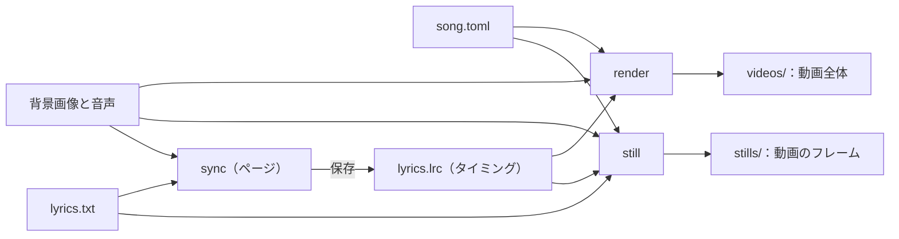

<!-- source: docs/en/USER_GUIDE.md blob 85876c1549beb4e6987334bbcc1949b9940cf9e4 -->
[English](../en/USER_GUIDE.md) | 日本語 · [目次に戻る](README.md)

> この文書は[英語版](../en/USER_GUIDE.md)の翻訳。内容が異なる場合は英語版が優先する。

# ユーザーガイド

lyrics-video-app をセットアップし、曲の字幕にタイミングを付け、動画のフレームを確かめ、動画全体を書き出す手順をまとめる。このアプリで歌詞動画を作る人向け。

曲ごとにフォルダを作り、そこに曲ファイルを置く。各コマンドがそれを読み、隣のフォルダに画像や動画を書き出す。
`sync` はブラウザでページを開き、字幕にタイミングを付ける。



## 1. セットアップ

```bash
brew install uv ffmpeg
uv sync
```

audio-spectrum-app をこのリポジトリの隣（`../audio-spectrum-app`）に置いておく必要がある。[開発](DEVELOPMENT.md) §1 を参照。
すべてオフラインで動く。

## 2. 曲ごとのフォルダ

曲ごとに、Git の対象外である `work/` の中か、リポジトリの外にフォルダを作る。

```text
work/my-song/
  song.toml      曲ファイル：歌詞、タイミング、音声、背景、曲名、フォント、デザイン
  lyrics.txt     1 行に 1 字幕
  lyrics.lrc     各字幕を歌う時刻（4 節）
```

例のファイルから始めるとよい。`examples/song.example.toml` を `work/my-song/song.toml` に、
`examples/lyrics.example.txt` を `work/my-song/lyrics.txt` にコピーして編集する。

### 歌詞ファイル

- UTF-8 のテキストで、1 行が 1 つの字幕。
- `;` で字幕を 2 行に分ける（`1 行目;2 行目`）。`;` が 2 つ以上ある行はエラーになる。区切り文字は曲ファイルで変えられる。
- 空行は飛ばす。ただし、`still --caption` の行番号には数える。

## 3. 動画の静止画：`still`

```bash
uv run lyrics-video still work/my-song/song.toml --time 3 62.5 --caption 4
```

指定した時刻（曲の秒数）に動画が映すフレームを、曲ファイルの隣の `stills/` に書き出す。ファイル名は `<デザイン>_<時刻>s.png`。
静止画には背景画像、曲名、その時点の字幕、クレジット、スペクトラムが重なっていて、動画のフレームとまったく同じになる。

静止画に出る字幕は次のとおり。

- タイミング（4 節）があれば、その時点の字幕を動画と同じフェードで出す。字幕が入れ替わる間は 2 つが重なる。
- `--caption` を付けると、どの時刻でもその行番号の字幕（0 から数え、空行も数える）を出す。デザインを見比べるときに使う。
- タイミングがなければ、`--caption` で指定した行、省略すると最初の字幕を出す。
- `--no-caption` なら字幕なし。

既存の画像は `--overwrite` なしでは置き換えない。1 つでもあれば何も書き出さない。

デザインを見比べるときは、`--design` に名前を並べる。曲ファイルに書いたデザインの上書き（曲名のフォントなど）はどのデザインにも効く。
`compare_<時刻>s.png` には、それらを半分の大きさで縦に並べる。

```bash
uv run lyrics-video still work/my-song/song.toml --time 62.5 --design classic soft panel
```

## 4. 字幕のタイミング

字幕の時刻は、歌詞ファイルの隣に置くタイミング付き歌詞ファイル（LRC）に書く。このファイルは `sync` で作る。
`still` がこれを使うよう、曲ファイルで名前を指定する。

```toml
timing = "lyrics.lrc"
```

### タップと調整：`sync`

```bash
uv run lyrics-video sync work/my-song/song.toml
```

ブラウザでページを開き、行の一覧の横で曲を再生する。ページはこの Mac の中でしか使えない。サーバーは `127.0.0.1` だけで待ち受け、
ほかの Web ページからの操作を拒む。止めるにはターミナルで `Ctrl+C` を押す。

1. **タップ：** `P` で再生し、次の行が始まったら `Space`、歌が途切れる前に今の行が終わったら `Enter` を押す。`Backspace` で直前の印を取り消す。
   色の付いた行が次に始まる行。
2. **調整：** 時刻をクリックする（または「調整」に切り替える）と、聴きながら波形を見て直せる。一時停止中は、波形の上の画像が
   再生位置での動画とまったく同じフレームになる。
3. **保存：** 保存ボタンか `⌘S` でタイミングファイルに書き込む。それまでは何も書き込まない。保存していない変更があるままページを離れようとすると確認が出る。
4. **動画を書き出す：** 保存したタイミングで、`render` コマンド（5 節）と同じく動画全体を `videos/<曲ファイル名>.mp4` に書き出す。
   - ボタンはすべて保存するまで押せない。そのため動画は常にタイミングファイルと一致する。
   - バーに進捗と残り時間が出る。キャンセルすると書き出しを止め、ファイルは残らない。
   - 既存の動画は、確認してから置き換える。書き出しが終わると「Finder で表示」で動画を選択できる。
   - 書き出し中も静止画は使えるが、保存は書き出しが終わるかキャンセルするまで待つ。
   - `Ctrl+C` でサーバーを止めると、書き出し中の処理もきれいにキャンセルする。

調整モードのキー：

| キー | 操作 |
|---|---|
| `↑` `↓`、`Tab` | 前後の行へ移る。開始と終了を切り替える |
| `←` `→`、`Shift`+`←` `→` | 選んだ時刻を 0.05 秒か 0.5 秒ずらす |
| `Enter` | 選んだ時刻を再生位置にする（時刻のない行に使う） |
| `Shift`+クリック、`Shift`+`↑` `↓`、`⌘`+クリック、`⌘`+`A` | 範囲、1 行追加、全行を選び、まとめてずらす（`Esc` で解除） |
| `R`、`Space` | 選んだ行の 2 秒前から再生する。再生と一時停止 |
| `Backspace`、`⌘S` | 取り消す（複数行をまとめてずらした操作は 1 回で戻る）。保存する |

拡大波形のマーカーはドラッグでも動かせる。

補足：

- タイミングファイルは曲ファイルの `timing` で決まる。このキーがなければ歌詞ファイルの名前の拡張子を `.lrc` にしたファイルになり、
  ページがキーを書き足すよう案内する。保存するとき、前のファイルを `<名前>.bak` として残す。
- 初回は歌詞ファイルから、2 回目からはタイミングファイルから行を読む。その間に歌詞ファイルが変わっていれば、追加と削除の行を一覧にし、
  変わっていない行（順に照合する）の時刻は残す。新しい行には自分で時刻を付けるまで時刻がない。
- 反応オフセット（ms）は、タップした時刻から毎回差し引く。既定は 0。
- 再生中の画像は、デザインの先行、フェード、切り替え方に従った簡易表示になる。
- ページは日本語、英語、スペイン語、フランス語で表示できる。

### タイミングファイル

```text
[00:12.40]first row;second row
[00:17.85]the next caption
[00:23.10]
[00:41.00]after an instrumental part
```

- UTF-8 のテキスト。各行は時刻 `[分:秒.百分の一秒]` のあとに字幕を書く。歌詞ファイルと同じく `;` で 2 行に分ける。
  時刻は歌い始めの時刻。
- 字幕のない時刻だけの行は、すぐ上の字幕をそこで終える。歌が途切れるところに使う。この行がなければ字幕は次の字幕が
  始まるまで続き、最後の字幕は曲の終わりまで続く。
- 時刻は行ごとに増え、曲の長さに収まっていなければならない。違反するとエラーになり、その行番号を示す。
- 時刻のない行は、まだタイミングを付けていない字幕として扱い、表示しない。空行と `[ti:...]` などのタグは飛ばす。
- `still` は字幕の文言を歌詞ファイルではなくこのファイルから取る。

### 字幕が時刻に合わせて出入りするしくみ

字幕の出入りはデザインの 3 つの設定（6 節）で決まる。これらを変えても、タイミングを付け直す必要はない。

| 設定 | 既定値 | 意味 |
|---|---|---|
| `caption.lead_seconds` | `0.2` | 歌い始めのこの秒数前から字幕が現れ始める。目が先に字幕をとらえられる |
| `caption.fade_seconds` | `0.3` | 字幕のフェードイン・アウトにかかる秒数 |
| `caption.transition` | `"sequential"` | 続けて歌う字幕の切り替え方。`"sequential"` は古い字幕が消えきってから新しい字幕が現れるので、2 つの文字が重ならない。`"crossfade"` は古い字幕が消えていくのと同時に新しい字幕が現れる |

歌が途切れるところでは、終わりの時刻から字幕が消え始める。フェード 2 回分より短い字幕は、そのぶん速くフェードする。

## 5. 動画全体：`render`

```bash
uv run lyrics-video render work/my-song/song.toml
```

曲の音声付きの歌詞動画を、曲ファイルの隣の `videos/<曲ファイル名>.mp4` に書き出す（`song.toml` なら `videos/song.mp4`）。
各フレームは 3 節の静止画と同じで、背景、タイトル、タイミングどおりの字幕、クレジット、その上のスペクトラムからなる。
サイズとフレームレートは曲ファイルの `[video]` に従う。

時間のかかる処理に入る前に、すぐ失敗しうるもの（曲ファイル、タイミング、背景画像、フォント、既存の動画）をすべて確かめ、概要を表示する。

```text
Song: Song Title (song.wav, 279.5 s)
Design: soft; timed captions: 18
Rendering work/my-song/videos/song.mp4
```

ここでタイトルと音声ファイルを確かめる。別の曲からコピーした曲ファイルなら、すぐ気付ける。

- 曲ファイルに `audio` と `timing` が要る。
- 時刻のない行は警告に一覧が出て、動画には入らない。下書きにはこれが便利だ。
- 進捗は標準エラー出力に出る。`Ctrl+C` で止めるとファイルは残らない。
- 既存の動画は `--overwrite` なしでは置き換えない。動画はまず一時ファイルに書くので、最終的な名前のファイルは常に完全な状態だ。
- 4.7 分の曲なら M1 の Mac で約 2 分半かかり、ファイルは約 125 MB になる。

曲全体を書き出す前に一部だけ確かめるなら、開始位置と長さを指定する。

```bash
uv run lyrics-video render work/my-song/song.toml --start 60 --duration 15
```

これで `videos/song_60s-75s.mp4` ができる（`--duration` を省くと `song_60s-end.mp4`）。
フレームは動画全体の同じ時刻のものと同一で、音声もそれに合わせて切り出す。

| オプション | 既定値 | 意味 |
|---|---|---|
| `-o`、`--output FILE` | `videos/<曲ファイル名>.mp4` | 別の動画ファイル。H.264 なら `.mp4`、ProRes なら `.mov` |
| `--overwrite` | オフ | 既存の動画を置き換える |
| `--start SECONDS`、`--duration SECONDS` | 曲全体 | 曲の一部だけを書き出す |
| `--design NAME` | 曲ファイルの指定 | 別のデザイン（組み込みの名前かファイル）。曲ファイルのデザイン上書きも効く |
| `--workers N` | `0`（自動） | 描画プロセスの数。`1` なら 1 プロセスで描く |
| `--codec CODEC` | `h264` | `h264` か `prores`（ProRes 422。編集向けで、ファイルはずっと大きい） |
| `--crf N` | `18` | H.264 の画質（0〜51）。小さいほど高画質でファイルが大きい |

## 6. デザイン

フレームの部品がどう見えるかをまとめたものが**デザイン**。曲ファイルに `design = "soft"` と書いて選ぶか、
自分のデザインファイルを `design = "my-design.toml"` で指定する。

### フレームの部品

フレームは下から順に次の部品を重ねてできている。

| 部品 | 内容 |
|---|---|
| 背景 | `background_image`。画面を覆うように拡大して切り取り、引き伸ばさない。画像がなければ黒 |
| 曲名 | `title`。アプリが描く |
| 字幕 | その時点の字幕（4 節）。フェードイン・アウトする |
| クレジット | `credits` の各行。曲の最初と最後の数秒、暗くした画面の上に出す |
| スペクトラム | `[spectrum]` のプリセットと上書き設定に従い、audio-spectrum-app が描く |

### 組み込みのデザイン

既定は `soft`。

| デザイン | 曲名 | 字幕 | クレジット |
|---|---|---|---|
| `soft` | 小さく、左上。細い線付き | 下から立ち上がる柔らかい陰の上 | 小さく、右下 |
| `classic` | 大きく、上部中央 | 画面下端の不透明な帯。旧字幕画像の決まりで描く | 暗くした画面の中央 |
| `panel` | 字間を広げて、上部中央 | 下寄りの、すりガラス風の角丸の枠の中（背後の背景をぼかす） | 中央、同じ種類の枠の中 |

どのデザインでも、字幕は今と同じく左寄せで 2 行まで。

### 一部の値だけ変える

`[design]` テーブルに、デザインの `name` と変えたい部品を書く。

```toml
[design]
name = "soft"

[design.title]
font = "~/path/to/title-font.otf"   # 曲名だけ fonts.default と別のフォントにする
size = 64

[design.caption]
size = 56
```

どの部品も、自分の `font` を指定しなければ `fonts.default` を使う。色は `"#RRGGBB"` で書く。

### デザインのキー

大きさは高さ 1080 ピクセルの画面でのピクセル数で書く。実際の値は動画の高さに合わせて拡大縮小する。

| 部品 | キー |
|---|---|
| `background` | `focus`（`[x, y]`、0〜1。切り取るときに残す位置）、`dim`（0〜1）、`blur` |
| `title` | `enabled`、`position`（`"top-center"`、`"top-left"`）、`font`、`size`、`color`、`margin`、`letter_spacing`、`rule`、`rule_thickness`、`rule_gap`、`shadow` |
| `caption` | `style`（`"band"`、`"gradient"`、`"panel"`）、`align`（`"left"`）、`font`、`text_color`、`lead_seconds`、`fade_seconds`、`transition`（`"sequential"`、`"crossfade"`）。帯：`band_color`、`band_opacity`、`band_height`。陰と枠：`size`（最大の文字の大きさ）、`line_spacing`、`margin_x`、`margin_bottom`、`gradient`、`panel`、`shadow` |
| `credits` | `enabled`、`font`、`size`、`color`、`line_spacing`、`position`（`"center"`、`"bottom-right"`）、`margin_x`、`margin_bottom`、`dim`、`panel`、`show_seconds`、`fade_seconds`、`shadow` |
| `spectrum` | `set`：曲ファイルの `[spectrum] set` より先に適用するプリセットの上書き |
| `shadow`（`title`、`caption`、`credits` の中） | `blur`（0 で影なし）、`offset`、`color`、`opacity` |
| `gradient`（`caption` の中） | `height`、`color`、`opacity`（下端での不透明度） |
| `panel`（`caption`、`credits` の中） | `color`、`opacity`（色の濃さ）、`blur`（背後のぼかし）、`radius`、`padding`（`[x, y]`） |

## 7. 曲ファイル

曲ファイルは TOML で書く。パスは曲ファイルからの相対パスで、`~` はホームフォルダ。
`still` に要る `audio`、`render` に要る `audio` と `timing` を除き、どのキーも省略できる。

| キー | 既定値 | 意味 |
|---|---|---|
| `lyrics` | `"lyrics.txt"` | 歌詞ファイル |
| `separator` | `";"` | 字幕を 2 行に分ける文字。歌詞ファイルとタイミングファイルで使う |
| `timing` | なし | タイミングファイル（LRC）。`still` と `render` で使う（4 節） |
| `audio` | なし | 曲の音声（スペクトラムと動画の音声用、`still`、`render`） |
| `background_image` | なし | 動画の背景画像 |
| `title` | `""` | 曲名（1 行） |
| `credits` | `[]` | クレジットの各行。例：`["by Your Name"]` |
| `design` | `"soft"` | デザイン名かデザインファイル、または `name` と上書きを書いた `[design]` テーブル（6 節） |
| `fonts.default` | なし | 自分のフォントを指定しない、動画のすべての部品のフォント |
| `spectrum.preset` | `"default"` | audio-spectrum-app のプリセット名かプリセットファイル |
| `spectrum.set` | `[]` | プリセットの上書き（audio-spectrum-app の `--set` と同じ） |
| `video.width`、`video.height`、`video.fps` | `1920`、`1080`、`30` | フレームの大きさとフレームレート |

フォントはこのリポジトリに含めず、コピーもしない。曲ファイルはフォントの場所を指すだけ。実際の曲ファイルは
`work/` かリポジトリの外に置く。

バージョン 0.1 の曲ファイルには、削除した字幕画像コマンド用の `[captions]` と `[compare]` が残っていることがある。
今はそのセクション名を挙げたエラーで止まるので、削除する。`[captions]` で `separator` を変えていたなら、代わりにファイルの先頭に書く。

## 8. エラー

| 終了コード | 意味 |
|---|---|
| 0 | 完了 |
| 1 | 失敗。理由は標準エラー出力のメッセージに出る（曲ファイル、歌詞ファイルやタイミングファイル、フォント、画像、曲、既存の出力） |
| 2 | コマンドラインの使い方の誤り |
| 130 | `render` を `Ctrl+C` で止めた。動画は書き出していない |

エラーにはファイル名と、歌詞とタイミングなら行番号が出る。`still` はすべての画像を描き終えてから書き出し、`render` は始める前にすべてを確かめるので、
これらのエラーでは何も書き出さない。
各ファイルは完全に書き出すか、まったく書き出さないかのどちらかになる。
