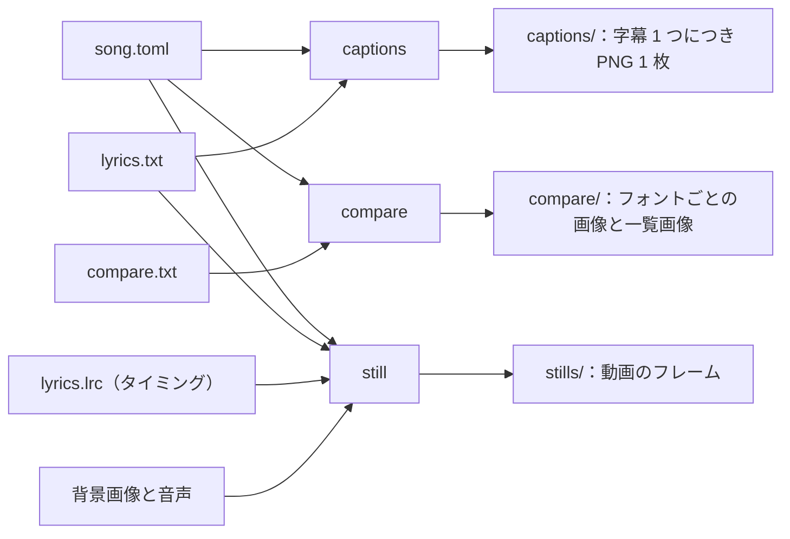

<!-- source: docs/en/USER_GUIDE.md blob bb9103c63fcb7fc47a228ed63ae36c3d645dd816 -->
[English](../en/USER_GUIDE.md) | 日本語 · [目次に戻る](README.md)

> この文書は[英語版](../en/USER_GUIDE.md)の翻訳。内容が異なる場合は英語版が優先する。

# ユーザーガイド

lyrics-video-app をセットアップし、曲の字幕画像を作り、字幕にタイミングを付け、動画のフレームを確かめる手順をまとめる。このアプリで歌詞動画を作る人向け。
動画全体の書き出しは後のフェーズで加わる。

曲ごとにフォルダを作り、そこに曲ファイルを置く。3 つのコマンドがそれを読み、隣のフォルダに画像を書き出す。



## 1. セットアップ

```bash
brew install uv ffmpeg
uv sync
```

audio-spectrum-app をこのリポジトリの隣（`../audio-spectrum-app`）に置いておく必要がある。[開発](DEVELOPMENT.md) §1 を参照。
すべてオフラインで動く。

## 2. 曲ごとのフォルダ

曲ごとに、Git の対象外である `work/` の中か、リポジトリの外にフォルダを作る。

```text
work/my-song/
  song.toml      曲ファイル：歌詞、色、フォント、出力先
  lyrics.txt     1 行に 1 字幕
  lyrics.lrc     各字幕を歌う時刻（任意、6 節）
  compare.txt    いくつかのフォントで試す 1〜2 行（任意）
```

例のファイルから始めるとよい。`examples/song.example.toml` を `work/my-song/song.toml` に、
`examples/lyrics.example.txt` を `work/my-song/lyrics.txt` にコピーして編集する。

### 歌詞ファイル

- UTF-8 のテキストで、1 行が 1 つの字幕。
- `;` で字幕を 2 行に分ける（`1 行目;2 行目`）。`;` が 2 つ以上ある行はエラーになる。区切り文字は曲ファイルで変えられる。
- 空行は飛ばす。ただし、これまでどおりファイル名の番号には数える。

## 3. 字幕画像：`captions`

```bash
uv run lyrics-video captions work/my-song/song.toml
```

字幕ごとに PNG を 1 枚、出力先（既定では曲ファイルの隣の `captions/`）に書き出す。ファイル名は `lyrics_<行番号>.png`。
行番号は 0 から数え、空行も含む。各画像は背景色の帯で、そこに字幕を文字色で左寄せに描く。

- 文字の大きさは 80 から始める。縦横それぞれ 50 px の余白を残してどの行も収まるまで、2 ずつ小さくする。
  2 行の字幕は 2 行とも同じ大きさにそろえる。
- 1 行なら上下の中央に、2 行なら上半分と下半分に置く。

旧歌詞画像スクリプトと同じ決まりなので、これまでどおり iMovie で使える。背景画像を画面いっぱいに置き、
各字幕画像を画面の一番下に横幅いっぱいで、フェード付きで重ねる。

既存の画像を黙って置き換えることはない。

- 出力先のファイルが 1 つでもあれば、何も書き出さずにその一覧を表示する。
- 置き換えるには `--overwrite` を付ける。
- 新しい歌詞の行数が減ったときは、古い画像が残らないよう、先に古いフォルダを消しておく。

## 4. フォント選び：`compare`

```bash
uv run lyrics-video compare work/my-song/song.toml
uv run lyrics-video compare work/my-song/song.toml --font-dir ~/path/to/fonts --font /System/Library/Fonts/ヒラギノ明朝\ ProN.ttc
```

比較用テキスト（`compare.txt`）の全行を、曲と同じ大きさと色で、すべてのフォントで描く。画像は比較用フォルダ
（既定では `compare/`）に書き出す。

- フォントと行ごとに `<フォントのファイル名>_<行番号>.png`
- `contact_sheet.png`：1 行目を全フォントで縦に並べ、それぞれの上にフォント名を添えた一覧画像

使うフォントは次のとおり。

- `compare.fonts` と、`compare.font_dirs` の中（サブフォルダも探す）にあるすべてのフォントファイル。
- `--font` と `--font-dir`（どちらも繰り返し指定できる）を付けると、その回だけ両方の一覧を置き換える。
- フォントファイルは `.ttf`、`.otf`、`.ttc`、`.otc`。コレクションは最初のフェイスを使う。

`--overwrite` の動きは `captions` と同じ。

## 5. 動画の静止画：`still`

```bash
uv run lyrics-video still work/my-song/song.toml --time 3 62.5 --caption 4
```

指定した時刻（曲の秒数）に動画が映すフレームを、曲ファイルの隣の `stills/` に書き出す。ファイル名は `<デザイン>_<時刻>s.png`。
静止画には背景画像、曲名、その時点の字幕、クレジット、スペクトラムが重なっていて、動画のフレームとまったく同じになる。

静止画に出る字幕は次のとおり。

- タイミング（6 節）があれば、その時点の字幕を動画と同じフェードで出す。字幕が入れ替わる間は 2 つが重なる。
- `--caption` を付けると、どの時刻でもその行番号の字幕（数え方は字幕画像の名前と同じ）を出す。デザインを見比べるときに使う。
- タイミングがなければ、`--caption` で指定した行、省略すると最初の字幕を出す。
- `--no-caption` なら字幕なし。

`--overwrite` の動きは `captions` と同じ。

デザインを見比べるときは、`--design` に名前を並べる。曲ファイルに書いたデザインの上書き（曲名のフォントなど）はどのデザインにも効く。
`compare_<時刻>s.png` には、それらを半分の大きさで縦に並べる。

```bash
uv run lyrics-video still work/my-song/song.toml --time 62.5 --design classic soft panel
```

## 6. 字幕のタイミング

字幕の時刻は、歌詞ファイルの隣に置くタイミング付き歌詞ファイル（LRC）に書く。曲ファイルでその名前を指定する。

```toml
timing = "lyrics.lrc"
```

このファイルを作るタップ用のページは後のバージョンで加わる。それまでは手で書く。

### タイミングファイル

```text
[00:12.40]first row;second row
[00:17.85]the next caption
[00:23.10]
[00:41.00]after an instrumental part
```

- UTF-8 のテキスト。各行は時刻 `[分:秒.百分の一秒]` のあとに字幕を書く。歌詞ファイルと同じく `;` で 2 行に分ける。
  時刻は歌い始めの時刻。
- 字幕のない時刻だけの行は、すぐ上の字幕をそこで終える。歌が途切れるところに使う。この行がなければ字幕は次の字幕が
  始まるまで続き、最後の字幕は曲の終わりまで続く。
- 時刻は行ごとに増え、曲の長さに収まっていなければならない。違反するとエラーになり、その行番号を示す。
- 時刻のない行は、まだタイミングを付けていない字幕として扱い、表示しない。空行と `[ti:...]` などのタグは飛ばす。
- `still` は字幕の文言を歌詞ファイルではなくこのファイルから取る。

### 字幕が時刻に合わせて出入りするしくみ

字幕の出入りはデザインの 3 つの設定（7 節）で決まる。これらを変えても、タイミングを付け直す必要はない。

| 設定 | 既定値 | 意味 |
|---|---|---|
| `caption.lead_seconds` | `0.2` | 歌い始めのこの秒数前から字幕が現れ始める。目が先に字幕をとらえられる |
| `caption.fade_seconds` | `0.3` | 字幕のフェードイン・アウトにかかる秒数 |
| `caption.transition` | `"crossfade"` | 続けて歌う字幕の切り替え方。`"crossfade"` は古い字幕が消えていくのと同時に新しい字幕が現れる。`"sequential"` は古い字幕が消えきってから新しい字幕が現れる |

歌が途切れるところでは、終わりの時刻から字幕が消え始める。フェード 2 回分より短い字幕は、そのぶん速くフェードする。

## 7. デザイン

フレームの部品がどう見えるかをまとめたものが**デザイン**。曲ファイルに `design = "soft"` と書いて選ぶか、
自分のデザインファイルを `design = "my-design.toml"` で指定する。

### フレームの部品

フレームは下から順に次の部品を重ねてできている。

| 部品 | 内容 |
|---|---|
| 背景 | `background_image`。画面を覆うように拡大して切り取り、引き伸ばさない。画像がなければ黒 |
| 曲名 | `title`。アプリが描く |
| 字幕 | その時点の字幕（6 節）。フェードイン・アウトする |
| クレジット | `credits` の各行。曲の最初と最後の数秒、暗くした画面の上に出す |
| スペクトラム | `[spectrum]` のプリセットと上書き設定に従い、audio-spectrum-app が描く |

### 組み込みのデザイン

既定は `soft`。

| デザイン | 曲名 | 字幕 | クレジット |
|---|---|---|---|
| `soft` | 小さく、左上。細い線付き | 下から立ち上がる柔らかい陰の上 | 小さく、右下 |
| `classic` | 大きく、上部中央 | 画面下端の不透明な帯。旧字幕画像の決まりで描く | 暗くした画面の中央 |
| `panel` | 字間を広げて、上部中央 | 下寄りの、すりガラス風の角丸の枠の中（背後の背景をぼかす） | 中央、同じ種類の枠の中 |

どのデザインでも、字幕は今と同じく左寄せで 2 行まで。

### 一部の値だけ変える

`[design]` テーブルに、デザインの `name` と変えたい部品を書く。

```toml
[design]
name = "soft"

[design.title]
font = "~/path/to/title-font.otf"   # 曲名だけ fonts.default と別のフォントにする
size = 64

[design.caption]
size = 56
```

どの部品も、自分の `font` を指定しなければ `fonts.default` を使う。色は `"#RRGGBB"` で書く。

### デザインのキー

大きさは高さ 1080 ピクセルの画面でのピクセル数で書く。実際の値は動画の高さに合わせて拡大縮小する。

| 部品 | キー |
|---|---|
| `background` | `focus`（`[x, y]`、0〜1。切り取るときに残す位置）、`dim`（0〜1）、`blur` |
| `title` | `enabled`、`position`（`"top-center"`、`"top-left"`）、`font`、`size`、`color`、`margin`、`letter_spacing`、`rule`、`rule_thickness`、`rule_gap`、`shadow` |
| `caption` | `style`（`"band"`、`"gradient"`、`"panel"`）、`align`（`"left"`）、`font`、`text_color`、`lead_seconds`、`fade_seconds`、`transition`（`"crossfade"`、`"sequential"`）。帯：`band_color`、`band_opacity`、`band_height`。陰と枠：`size`（最大の文字の大きさ）、`line_spacing`、`margin_x`、`margin_bottom`、`gradient`、`panel`、`shadow` |
| `credits` | `enabled`、`font`、`size`、`color`、`line_spacing`、`position`（`"center"`、`"bottom-right"`）、`margin_x`、`margin_bottom`、`dim`、`panel`、`show_seconds`、`fade_seconds`、`shadow` |
| `spectrum` | `set`：曲ファイルの `[spectrum] set` より先に適用するプリセットの上書き |
| `shadow`（`title`、`caption`、`credits` の中） | `blur`（0 で影なし）、`offset`、`color`、`opacity` |
| `gradient`（`caption` の中） | `height`、`color`、`opacity`（下端での不透明度） |
| `panel`（`caption`、`credits` の中） | `color`、`opacity`（色の濃さ）、`blur`（背後のぼかし）、`radius`、`padding`（`[x, y]`） |

## 8. 曲ファイル

曲ファイルは TOML で書く。パスは曲ファイルからの相対パスで、`~` はホームフォルダ。`captions` に要る `captions.font` と、
`still` に要る `audio` を除き、どのキーも省略できる。

| キー | 既定値 | 意味 |
|---|---|---|
| `lyrics` | `"lyrics.txt"` | 歌詞ファイル |
| `timing` | なし | タイミングファイル（LRC）。`still` で使う（6 節） |
| `audio` | なし | 曲の音声（スペクトラム用、`still`） |
| `background_image` | なし | 動画の背景画像 |
| `title` | `""` | 曲名（1 行） |
| `credits` | `[]` | クレジットの各行。例：`["by Your Name"]` |
| `design` | `"soft"` | デザイン名かデザインファイル、または `name` と上書きを書いた `[design]` テーブル（7 節） |
| `fonts.default` | なし | 自分のフォントを指定しない、動画のすべての部品のフォント |
| `spectrum.preset` | `"default"` | audio-spectrum-app のプリセット名かプリセットファイル |
| `spectrum.set` | `[]` | プリセットの上書き（audio-spectrum-app の `--set` と同じ） |
| `video.width`、`video.height`、`video.fps` | `1920`、`1080`、`30` | フレームの大きさとフレームレート |
| `captions.output_dir` | `"captions"` | 字幕画像の出力先 |
| `captions.size` | 背景画像の大きさ、なければ `[1440, 232]` | 各画像の幅と高さ |
| `captions.background` | `"#000000"` | 背景色：`"#RRGGBB"`、または中心のピクセルの色を使う画像ファイル |
| `captions.text_color` | `"#FFFFFF"` | 文字色（指定方法は背景色と同じ） |
| `captions.font` | なし | フォントファイル |
| `captions.font_index` | `0` | `.ttc` コレクション内のフェイス番号 |
| `captions.separator` | `";"` | 字幕を 2 行に分ける文字 |
| `captions.file_prefix` | `"lyrics"` | ファイル名の先頭 |
| `compare.text` | `"compare.txt"` | フォント比較に使うテキスト |
| `compare.output_dir` | `"compare"` | 比較画像の出力先 |
| `compare.fonts` | `[]` | 比較するフォントファイル |
| `compare.font_dirs` | `[]` | 中のフォントをすべて比較するフォルダ |

フォントはこのリポジトリに含めず、コピーもしない。曲ファイルはフォントの場所を指すだけ。実際の曲ファイルは
`work/` かリポジトリの外に置く。

## 9. 旧歌詞画像スクリプトからの移行

旧版で入力していた 0 か 1 の代わりに、コマンド `captions` か `compare` を選ぶ。旧 `conf.toml` のキーは、曲ファイルの次のキーに対応する。

| 旧 `conf.toml` | 曲ファイル |
|---|---|
| `input.background_color`（見本 PNG） | `captions.background = "back.png"`（同じ PNG、またはその色を `"#RRGGBB"` で）。画像の大きさが字幕の大きさになる |
| `input.text_color`（見本 PNG） | `captions.text_color` |
| `input.lyrics_text_single` | `lyrics` |
| `input.lyrics_text_multi` | `compare.text` |
| `output.output_dir_single`、`output_dir_multi` | `captions.output_dir`、`compare.output_dir` |
| `font.font_path_single`、`font_path_multi` | `captions.font`、`compare.fonts` |
| `separator.separator` | `captions.separator` |
| `prefix.prefix_image_num` | `captions.file_prefix` |
| `margin.margin_text_x`、`margin_text_y` | 50 で固定 |

旧スクリプトとの違い：

- 入力が同じなら、大きさ、色、文字の大きさ、配置、ファイル名も同じになる。フォントライブラリが変わったため、
  ところどころで字が 1 px ほどずれることはあるが、見た目は変わらない。
- 比較画像の名前にはフォントのファイル名全体を使う（`my-font-2.04_0.png`。旧版は最初のドットで切っていた）。
  一覧画像は新しく加えた。
- `--overwrite` を付けなければ既存の画像は上書きしない。曲ファイル、歌詞ファイル、フォントにエラーがあれば、画像は 1 枚も書き出さない。

## 10. エラー

| 終了コード | 意味 |
|---|---|
| 0 | 完了 |
| 1 | 失敗。理由は標準エラー出力のメッセージに出る（曲ファイル、歌詞ファイルやタイミングファイル、フォント、画像、曲、収まらない字幕、既存の出力） |
| 2 | コマンドラインの使い方の誤り |

エラーにはファイル名と、歌詞とタイミングなら行番号が出る。すべての画像を描き終えてから書き出すので、これらのエラーでは何も書き出さない。
各ファイルは完全に書き出すか、まったく書き出さないかのどちらかになる。
